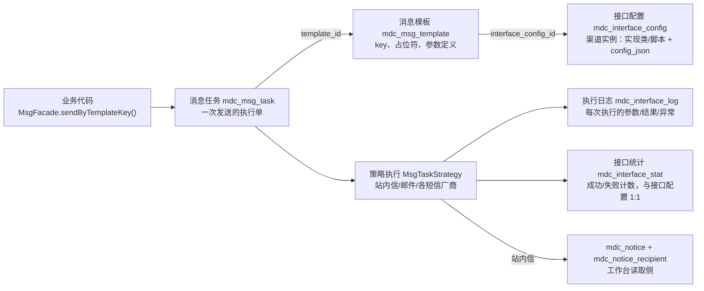
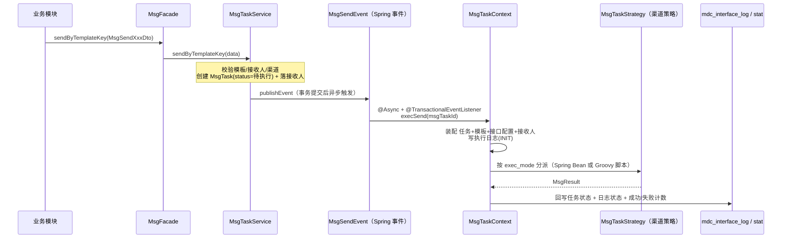

平台的消息体系负责站内信、短信、邮件三类消息的**发送、路由与追踪**。它的设计目标是：**任意业务模块只要按模板发起一次发送，平台负责选渠道、渲染内容、记录执行日志、记统计数据**——业务代码不需要关心任何短信 SDK 或 SMTP 配置。

读完本章各篇，您应当能够：

- 在任意模块用 `MsgFacade.sendByTemplateKey()` 发送站内信 / 短信 / 邮件；
- 配置消息模板（包括短信模板「厂商平台 + 本项目」两处配置的关系）；
- 通过「接口配置」新增或扩展发送渠道（如微信模板消息、移动端推送），无需改动框架代码；
- 分清控制台-消息管理、工作台-消息中心、右上角通知铃铛三个前端入口的职责与数据来源。

## 核心概念：模板 → 任务 → 渠道接口

一次发送由四个对象协作完成，对应四张核心表：

| 概念          | 表                                          | 一句话职责                                                    |
| ----------- | ------------------------------------------ | -------------------------------------------------------- |
| **消息模板**    | `mdc_msg_template`                         | 发送的内容蓝图：模板标识 `key`（唯一）、FreeMarker 占位符、参数定义、短信模板编码/签名     |
| **消息任务**    | `mdc_msg_task` + `mdc_msg_task_recipient`  | 一次发送的执行单：状态机（草稿/待执行/成功/失败）、接收人、渲染参数、`bizId/bizType` 业务追踪 |
| **接口配置**    | `mdc_interface_config`                     | 一个「渠道实例」= 一条接口配置：执行方式（实现类/脚本）+ 密钥参数 `config_json`        |
| **执行日志/统计** | `mdc_interface_log` / `mdc_interface_stat` | 每次执行的流水与成败；统计表与接口配置同 ID 一比一                              |

## 发送总链路

几个关键设计决策：

1. **异步不依赖 MQ**：执行通过 Spring 事件 + `@Async` 线程池（yml `mdp.async`），且用 `@TransactionalEventListener` 保证**发送方事务提交后**才执行——任务和接收人一定先落库成功。
2. **策略模式 + 数据库注册**：渠道策略实现 `MsgTaskStrategy` 接口注册为 Spring Bean，「接口配置」页面的 `impl_class` 字段填 Bean 名即完成绑定；也可以把整个策略写成 Groovy 脚本存进 `script` 字段，运行时编译加载。
3. **每次发送必有流水**：无论成败，`mdc_interface_log` 都会记录执行参数、返回结果、异常信息；`mdc_interface_stat` 按接口配置累计成功/失败次数——这就是「接口统计」页面的数据来源。
4. **渠道密钥存数据库**：SMTP 账号、短信 AccessKey 全部存在 `mdc_interface_config.config_json`，由控制台页面维护，不在 yml/Nacos 中。

## 篇目导航

| 篇目                        | 内容                                            | 关键收获                       |
| ------------------------- | --------------------------------------------- | -------------------------- |
| [发送消息](发送消息.md)           | 三个发送入口（内部调用 / 微服务 Feign / 开放 API）、三种消息 DTO 写法 | 业务模块发消息的标准姿势与事务边界          |
| [消息模板](消息模板.md)           | 模板字段、FreeMarker 占位符与 `_mdp` 全局参数、短信模板双处配置     | 模板 key 的命名约定与内置模板清单        |
| [接口配置与渠道扩展](接口配置与渠道扩展.md) | 渠道接口设计、config_json 参数管理、新增渠道两种模式（实现类/脚本）      | 以「微信模板消息」为例的完整扩展步骤         |
| [消息任务与统计](消息任务与统计.md)     | 任务状态机、控制台「消息管理」各页面、执行日志与接口统计                  | 消息任务与「数据统计-消息通知」看板的关系      |
| [消息读取与前端入口](消息读取与前端入口.md) | 站内信读取链路、已读/未读机制                               | 消息管理 vs 消息中心 vs 通知铃铛的区别与关系 |

## 与其他章节的关系

- **接口配置、接口统计属于消息体系**：它们是消息渠道的抽象与执行统计，与开放平台的「事件推送/接口回调」（Webhook，见 [调用链路与扩展点](../open/调用链路与扩展点.md)）是完全独立的两套机制，不要混淆。
- 消息发送成功率、模板排行等**看板指标**见 [数据统计](../数据统计.md) 的「消息通知」页面，数据源即本章的 `mdc_interface_stat` / `mdc_msg_task` / `mdc_msg_template`。
- 第三方应用通过 SDK 发消息（`msg.sendNotice` 等开放接口）的接入方式见 [应用接入-接口调用](../../integration/接口调用.md)。
- 站内信落库所在的 workbench 模块与 facade 双实现（单体/微服务）的机制说明见 [架构介绍](../../info/架构介绍.md)。
