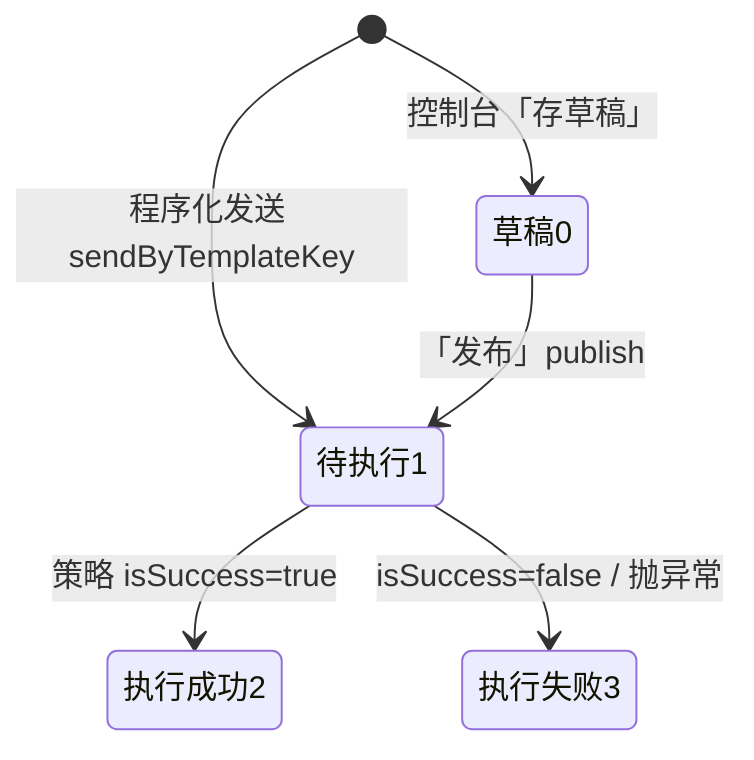

「消息任务」是消息体系的核心表：**每一次发送（无论来自后台手工发布、业务代码还是第三方 API）都会先落一条任务记录**，执行结果、接收人、日志全部可回溯。本篇梳理任务生命周期、控制台「消息管理」的功能全景与执行统计的设计。

## 1. 任务模型

```sql
-- mdc_msg_task（节选）
`template_id`  bigint       COMMENT '消息模板',
`type`         smallint     COMMENT '消息类型 [1-站内信 2-短信 3-邮件]',   -- 取模板的 msg_type
`status`       smallint     COMMENT '执行状态 [0-草稿 1-待执行 2-执行成功 3-执行失败]',
`channel`      smallint NOT NULL COMMENT '发送渠道 [1-后台发送 2-API发送 3-JOB发送]',
`msg_category` smallint     COMMENT '消息分类 [1-待办 2-公告 3-预警]',       -- 站内信专用
`recipient_scope` smallint COMMENT '接收范围 [0-所有人 1-指定用户 2-指定角色 3-指定部门]',
`param`        text         COMMENT '渲染参数 [{key,value}]',
`title`/`content`           COMMENT '渲染后的成品内容（执行时回写）',
`url`          varchar(255) COMMENT '跳转地址',                              -- 站内信专用
`biz_id`/`biz_type`        COMMENT '业务追踪（API/JOB 发送时指定）',
`is_timing`/`scheduled_send_time` COMMENT '定时发送',
`send_time`    datetime     COMMENT '发送时间',
`sender_id`/`org_id`/`author` COMMENT '发送人/发布部门/发布人展示名'
```

接收人存 `mdc_msg_task_recipient`（`msg_task_id` + `recipient`，recipient 语义随消息类型变化：站内信=用户ID、短信=手机号、邮件=邮箱）。任务删除时级联清理接收人与富文本内容中的附件（`MsgTaskServiceImpl.removeByIds`）。

### 1.1 状态机



`channel` 字段标识任务来源：**1-后台发送**（控制台发布，内容为成品、跳过模板渲染）、**2-API发送**（`MsgFacade`/开放接口）、**3-JOB发送**（定时任务代码里用 `buildJobSender()`）。定时任务（`isTiming=true`）落库后保持「待执行」，到点由 PowerJob 延迟实例触发执行（机制见 [发送消息](发送消息.md) §7）。

## 2. 控制台「消息管理」功能全景

前端页面在 `apps/web-console/src/views/console/message/`（后端动态路由，菜单名常量见 `constants/menu.ts`），后端 Controller 集中在 `console-web/.../controller/message/`：

| 页面   | 视图目录                         | 后端前缀                               | 核心端点                                           | 说明                                                        |
| ---- | ---------------------------- | ---------------------------------- | ---------------------------------------------- | --------------------------------------------------------- |
| 消息管理 | `msgManage/`                 | `/console/message/msgTask`         | `page`、`delete`                                | 全部任务的分页列表                                                 |
| 发布消息 | `msgManage/modules/form.vue` | 同上                                 | `save`、`update`、`publish`、`getById`            | 富文本（AiEditor）编辑站内信，支持定时与按范围选接收人；「存草稿」调 save，「发布」调 publish |
| 任务详情 | `msgTask/modules/detail.vue` | `msgTaskRecipient`、`interfaceLog`  | 各自 `page`                                      | Tab 结构：消息 / 接收人 / 日志                                      |
| 消息模板 | `msgTemplate/`               | `/console/message/msgTemplate`     | `save`、`update`、`delete`、`page`                | 见 [消息模板](消息模板.md)                                         |
| 接口配置 | `interfaceConfig/`           | `/console/message/interfaceConfig` | `save`、`update`、`updateConfig`、`listImplClass` | 见 [接口配置与渠道扩展](接口配置与渠道扩展.md)                               |
| 接口日志 | `interfaceLog/`              | `/console/message/interfaceLog`    | `page`、`delete`                                | 每次执行的流水                                                   |
| 接口统计 | `interfaceStat/`             | `/console/message/interfaceStat`   | `page`、`list`                                  | 成功/失败计数                                                   |

`publish` 接口比较特殊：它不是简单的状态切换「草稿→待执行」，而是**站内信发送的完整入口**——模板 key 从系统配置`NOTICE` 读取，消息任务绑定该模板后落库、落接收人并发事件执行。富文本里的图片存储到文件服务公开桶，消息任务与内容中上传的附件通过 `contentFileIds` 接口关联管理。

### 2.1 任务列表的数据权限

消息任务查询内置了多个数据范围处理器，这些处理器都只是MDP提供的一些数据权限的示例，实际使用时需要根据自身业务适当的微调。不同菜单/角色看不同口径的任务，二开新增查询入口时注意选对 handler 或复用现有注解配置。

> 自定义数据范围处理器如何编写、如何与「数据范围类型 + 角色/用户」关联配置（即 `DataScopeType` 枚举、`@DataScope` 注解与 handler 的绑定方式），见 [权限体系-数据权限](../数据权限.md)。

- MsgTaskSelfOrInnerDataScopeHandler
  
  本人创建的任务 + 全部站内信任务

- MsgTaskRecentDataScopeHandler
  
  只能查看近 30 天创建的任务

- MsgTaskInnerMsgDataScopeHandler
  
  只能查看站内信任务

## 3. 执行日志：mdc_interface_log

`MsgTaskContext.execSend()` 在调用策略**前**就写入一条 INIT 日志（记录任务ID、参数、开始时间），执行后回填状态与结果，`finally` 中保存——保证**无论成功、业务失败还是抛异常，都有一条完整流水**：

| 字段                                | 内容                                            |
| --------------------------------- | --------------------------------------------- |
| `msg_task_id`                     | 关联消息任务（任务详情「日志」Tab 按此查询）                      |
| `interface_stat_id`               | 关联接口配置/统计                                     |
| `status`                          | 1-初始化 2-成功 3-失败                               |
| `param`                           | 渲染参数快照（任务的 param JSON）                        |
| `result`                          | 策略 `MsgResult` 的 JSON（含短信厂商的原始响应 SmsResponse） |
| `error_msg`                       | 异常根因（`ExceptionUtil.getRootCauseMessage`）     |
| `exec_start_time`/`exec_end_time` | 执行耗时                                          |

排查「消息是否发送出去了」就在：任务详情 → 日志 Tab。

## 4. 接口统计：mdc_interface_stat

与接口配置同 ID 一比一，记录累计维度的健康度：

```sql
`name`          varchar(255) COMMENT '接口名称',
`success_count` int COMMENT '成功次数',
`fail_count`    int COMMENT '失败次数',
`last_exec_at`  datetime(3) COMMENT '最近执行时间'
```

每次执行成功/失败分别 `incrSuccessCount`/`incrFailCount`。它是两个统计视图的数据源：

- 控制台「接口统计」页面（`/console/message/interfaceStat/page`）；
- 系统概览的「消息成功率」指标（`DashboardConsoleServiceImpl`，成功数/（成功+失败））。

## 5. 消息通知看板（数据统计-消息通知）

数据统计模块的「消息通知」页面（`/console/dashboard/message/*`）站在**业务视角**聚合 `mdc_msg_task`/`mdc_msg_template`：

| 接口                                            | 指标                 |
| --------------------------------------------- | ------------------ |
| `GET /dashboard/message/overview`             | 消息概览（总量、成功率等）      |
| `GET /dashboard/message/typeDistribution`     | 按消息类型（站内信/短信/邮件）分布 |
| `GET /dashboard/message/categoryDistribution` | 按消息分类（待办/公告/预警）分布  |
| `GET /dashboard/message/trend`                | 发送趋势（多类型曲线）        |
| `GET /dashboard/message/templateRank`         | 模板使用排行             |

三层统计的分工一句话：**接口统计看「渠道健康度」（每次执行的成败），消息看板看「业务运营情况」（发了什么、给谁、趋势如何），接口日志看「单次执行的现场」**。

## 6. 二开注意事项

1. **失败无自动重试**：任务失败只置状态 3 + 日志 FAIL + 计数，不做补偿。业务上重要的消息（如审批提醒）建议业务侧自行扫描失败任务重发，或直接再次调用发送（注意接收人是否会重复收到）。
2. **定时发送已实现**：链路为「落库（待执行）→ PowerJob 延迟实例 → worker-server `MsgTaskSendProcessor` 到点执行」，与即时发送共用 `MsgTaskContext.execSend`（详见 [发送消息](发送消息.md) §7）。依赖 PowerJob Server 在线 + 常驻 job 配置（`powerjob.server.msg-job-id`）+ worker-server 在线；定时任务在到点前停留在「待执行」状态属正常现象，排查未发送时先确认这三者。
3. **任务与站内信是两段数据**：任务/日志/统计在 console 库，站内信正文与已读状态在 workbench 的 `mdc_notice`/`mdc_notice_recipient`（经 `NoticeFacade` 写入）。只删任务不会删已发出的站内信。
4. **批量发送的成本**：scope=所有人时会把全部启用用户展开成逐条 `mdc_notice_recipient`，大用户量下注意批次与索引（任务详情页按 `msg_task_id` 查接收人）。
5. **看板查询是实时 SQL**：与全站统计一致，无缓存，新增大维度统计时参考 [数据统计](../数据统计.md) 的口径要求（显式 `deleted_at = 0`、数据域隔离）。
