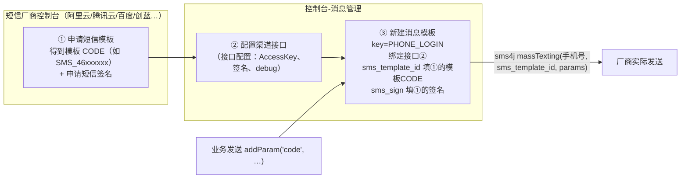

消息模板（`mdc_msg_template`）定义「一条消息内容是什么、有哪些参数、走哪个渠道」。业务发送时只认模板标识 `key`，模板内容随时可改而不用动代码。

## 1. 表结构

```sql
CREATE TABLE `mdc_msg_template` (
  `id`                 bigint NOT NULL COMMENT '主键',
  `interface_config_id` bigint NOT NULL COMMENT '接口ID',          -- 绑定的渠道接口
  `msg_type`           smallint NOT NULL DEFAULT '1' COMMENT '消息类型 [1-站内信 2-短信 3-邮件]',
  `key`                varchar(255) NOT NULL COMMENT '模板标识',     -- 业务发送时引用的唯一 key
  `name`               varchar(255) COMMENT '模板名称',
  `state`              bit(1) DEFAULT b'1' COMMENT '状态',
  `sms_template_id`    varchar(255) COMMENT '短信模板编码',          -- 短信厂商平台申请的模板ID
  `sms_sign`           varchar(255) COMMENT '短信签名',
  `title`              varchar(255) COMMENT '标题',                 -- FreeMarker 模板
  `content`            longtext COMMENT '发送内容',                  -- FreeMarker 模板（邮件为完整 HTML）
  `script`             text COMMENT '实现脚本',                      -- 可选 Groovy，发送前加工参数
  `param`              text COMMENT '参数定义 [{key,value}]'          -- 供前端表单渲染，说明需要哪些占位符
);
```

要点：

- **模板必绑定一个渠道接口**（`interface_config_id` → `mdc_interface_config`）。一个渠道接口可被多个模板复用（例如多个短信模板都绑阿里云接口）。
- `param` 存的是 `[{key1,value},{key2,value}]` JSON，作用是**给前端表单提示需要填哪些参数**，发送链路不校验它；真正参与渲染的是发送时 `addParam` 进来的值。
- 无审核流，改完即生效（`state` 控制启用/禁用）。

## 2. 占位符渲染：FreeMarker

模板 `title`/`content` 用 **FreeMarker 语法**渲染，变量来自发送时的 `paramList`，外加一个内置命名空间：

```java
AbstractMsgTaskStrategy.replaceVariable() 
→ FreeMarkerUtil.generateString()
```

- `${code}`、`${validityPeriod}` —— 业务发送时 `addParam` 传入的普通参数；
- `${_mdp.appName}`、`${_mdp.homeWebsiteUrl}` —— **系统内置参数**，渲染引擎自动注入，发送时无需传
- 短信只需要使用 content ，用不到title。

| 参数                       | 含义     | 默认值                  |
| ------------------------ | ------ | -------------------- |
| `${_mdp.appName}`        | 平台名称   | `主数据平台`              |
| `${_mdp.homeWebsiteUrl}` | 平台官网地址 | `https://mddata.top` |

内置参数来自 yml `mdp.msg.param.*`（`MsgProperties`，微服务版经 Nacos 可刷新），**可按需扩展新键**：

```yaml
mdp:
  msg:
    param:
      appName: '主数据平台'            # 模板里用 ${_mdp.appName}
      homeWebsiteUrl: 'https://...'  # 模板里用 ${_mdp.homeWebsiteUrl}
      supportPhone: '400-xxx'        # 新增键 → 所有模板可直接写 ${_mdp.supportPhone}
```

品牌、环境类信息建议都收敛到 `_mdp`——换环境部署只改 yml，不用逐个改模板。内置模板清单及其参数见 §4；调用方视角的「模板编码 + 参数」契约约定见 [发送消息](发送消息.md) §3。

内置邮件模板大量使用 `${_mdp.*}`，换环境只需改 yml，不用逐个改模板。

### 2.1 一个特例：后台发布的站内信不渲染

控制台「发布消息」页面的内容是运营在 AiEditor 富文本里编辑好的成品，此时任务上已有最终 `title/content`。执行器对 `channel=后台发送 且 type=站内信` 的任务**直接使用任务内容，跳过模板渲染**（`replaceVariable` 的短路分支）。程序化发送（API/JOB 渠道）一定走模板渲染。

### 2.2 可选的 Groovy 脚本参数加工

模板 `script` 字段可填一段 Groovy，在渲染前执行，用于**动态生成或加工参数**：

```java
// AbstractMsgTaskStrategy.replaceVariable 中的执行点
Map<String, Object> params = ...;                 // paramList → Map，再注入 _mdp
if (StrUtil.isNotEmpty(script)) {
    resultParams = GlueFactory.exeGroovyScript(script, params);  // 返回新的参数 Map
}
title   = FreeMarkerUtil.generateString(templateTitle, resultParams);
content = FreeMarkerUtil.generateString(templateContent, resultParams);
```

脚本接收整个参数 Map、返回替换后的 Map。注意脚本跑在 `GlueFactory` 的安全沙箱里（危险 Token 黑名单，见 [接口配置与渠道扩展](接口配置与渠道扩展.md) §4），且**不支持 Lombok 注解**。

## 3. 短信模板：两处配置缺一不可

短信内容不由本项目直接拼接——国内短信厂商要求先在**厂商平台**申请模板审核。所以一个短信模板要在**两个地方**配置，两者通过 `sms_template_id` 字段关联：



渲染细节：发送时把业务参数（如 `${code}` 的值）解析成 Map，连同 `sms_template_id` 一起交给 sms4j 的 `massTexting(phones, templateId, params)`，**厂商平台按其模板渲染**。本项目模板里的 `content`（"你的验证码为${code}"）只用于控制台展示与日志记录，不参与实际短信内容拼装——真实内容由厂商模板决定。

邮件没有这层：HTML 模板完整存在本项目 `content` 字段，由 FreeMarker 本地渲染。

## 4. 内置模板清单

`MsgTemplateKey`（`md-public/md-common-pojo`）集中定义了平台内置模板 key，二开新增模板建议同样在此登记常量，并**同步更新发送契约文档的模板参数清单**（[发送消息](发送消息.md) §3）——调用方靠这份清单才知道有哪些模板、各需什么参数：

| 模块     | key                                             | 名称            | 参数                                    | 说明                                                             |
| ------ | ----------------------------------------------- | ------------- | ------------------------------------- | -------------------------------------------------------------- |
| Notice | `NOTICE`                                        | 站内信内置模板       | `${title}`、`${content}`               | **系统配置 message 组 `NOTICE` 指向它**，控制台「发布消息」全部复用此模板；content 为透传占位 |
| Sms    | `PHONE_REGISTER` / `PHONE_LOGIN` / `PHONE_EDIT` | 注册/登录/换绑手机验证码 | `${code}`                             | content=`你的验证码为${code}`                                        |
| Email  | `FORGET_PASSWORD_BY_EMAIL`                      | 忘记密码          | `${resetPasswordUrl}`、`${expireTime}` | 重置链接类邮件                                                        |
| Email  | `EMAIL_REGISTER` / `EMAIL_LOGIN` / `EMAIL_EDIT` | 邮箱注册/登录/换绑验证码 | `${code}`、`${validityPeriod}`         | 完整 HTML，另用 `${_mdp.appName}` 等内置参数                             |

::: warning
系统配置（`mdc_config`，message 组）里的 `NOTICE` 键值指向站内信模板 key，是「发布消息」功能的入口配置，**请勿删除**；如需替换站内信模板样式，改模板或换个 key 再同步系统配置即可。
:::

## 5. 二开：新增一个模板

以「主数据审批通过通知（邮件）」为例：

1. **选/建渠道接口**：邮件场景直接复用内置「邮件接口」（EMAIL）；新渠道则先到「接口配置」创建（见 [接口配置与渠道扩展](接口配置与渠道扩展.md)）；
2. **建模板**：控制台-消息管理-消息模板-新增，填写：
   - 模板标识 `key`（如 `MDM_APPROVAL_PASS`，全局唯一，建议全大写下划线并在 `MsgTemplateKey` 登记常量）；
   - 消息类型、绑定接口；
   - 标题/内容按 FreeMarker 写占位符；在 `param` 里登记参数清单（前端表单会据此渲染说明）；
   - 模板创建后**同步更新模板参数清单文档**（[发送消息](发送消息.md) §3 的发送契约），告知调用方模板编码与参数；
3. **业务代码发送**：`msgFacade.sendByTemplateKey(new MsgSendMailDto().setTemplateKey("MDM_APPROVAL_PASS").addRecipient(...).addParam(...))`；
4. **验证**：消息任务列表应出现一条 2-执行成功的记录，任务详情的日志 Tab 可看到渲染结果与接口返回。

短信模板额外做 §3 的厂商侧申请。新增站内信模板时注意：程序化发送（`sendByTemplateKey`）可指定任意模板 key；而「发布消息」页面固定用系统配置 `NOTICE` 指向的那一个。
