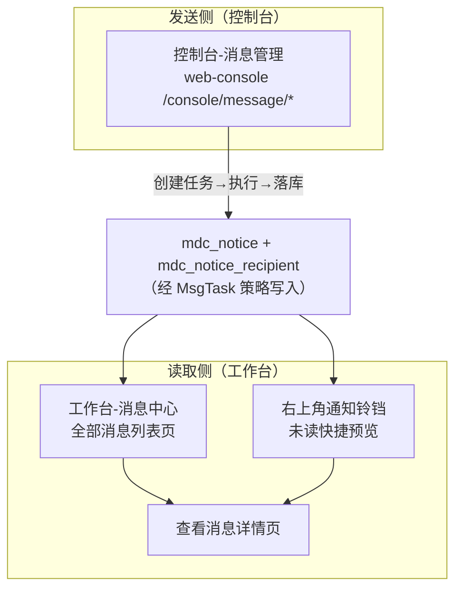

站内信发出后，用户从哪里看到它？平台有**三个前端入口**，职责完全不同却共享同一条数据链路。本篇讲清读取侧的表结构、接口与三者关系。

## 1. 读取侧数据链路

站内信的「正文」和「每个用户的已读状态」分表存储（workbench 模块）：

```sql
-- mdc_notice：一条站内信一份（由消息任务执行时经 NoticeFacade 写入）
`task_id`      bigint  COMMENT '来源消息任务',
`title`/`content`       COMMENT '渲染后的标题/富文本',
`msg_category` smallint COMMENT '消息分类 [1-待办 2-公告 3-预警]',
`author`       varchar(255) COMMENT '发布人',
`url`          varchar(255) COMMENT '跳转地址'

-- mdc_notice_recipient：一个接收人一份
`notice_id` bigint  COMMENT '站内信ID',
`user_id`   bigint  COMMENT '接收人',
`read`      bit     DEFAULT b'0' COMMENT '是否已读',
`read_time` datetime COMMENT '已读时间'
```

后端读取接口在 `workbench-web/.../NoticeController`：

| 端点                    | 功能   | 关键点                                                                     |
| --------------------- | ---- | ----------------------------------------------------------------------- |
| `POST /notice/page`   | 分页查询 | `notice INNER JOIN notice_recipient` 按 `user_id` 过滤；`read` 字段控制已读/未读/全部 |
| `GET /notice/getById` | 详情   | 详细内容                                                                    |
| `POST /notice/mark`   | 标记已读 | body 传 id 数组，写 `read=true, read_time`                                   |
| `POST /notice/delete` | 删除   | 删的是**接收人记录**（自己视角），不影响他人                                                |

## 2. 三个入口：区别与关系



|          | 控制台-消息管理                                | 工作台-消息中心                                        | 右上角通知铃铛                      |
| -------- | --------------------------------------- | ----------------------------------------------- | ---------------------------- |
| **所在应用** | web-console（管理端）                        | web-workbench（用户端）                              | web-workbench（用户端）           |
| **视角**   | 发送方/运维：管理**所有**人的消息任务                   | 接收方/用户：看**自己的**站内信                              | 接收方/用户：未读消息快捷预览              |
| **数据来源** | `mdc_msg_task`（+ 接收人/日志/统计/模板/接口配置全套管理） | `mdc_notice` ⋈ `mdc_notice_recipient`（按 userId） | 同消息中心，只取 `read=false` 前 10 条 |
| **能做什么** | 发布消息、管理模板/渠道/任务、查日志统计                   | 查看全部/已读/未读、标记已读、批量已读、删除                         | 预览未读、单条已读并跳转、全部已读、去消息中心      |
| **呈现位置** | 独立菜单「消息管理」                              | 工作台菜单「消息中心」                                     | 基础布局 header（仅工作台有）           |

三句话总结：

1. **消息管理管「发」**：它操作的是消息任务和模板/渠道，看到的是全平台的发送记录，不是某个用户的收件箱；
2. **消息中心管「收」**：用户的完整收件箱（含已读），铃铛只是它的未读子集快捷入口；
   
   

## 3. 前端实现要点

### 3.1 消息中心（web-workbench）

- 页面：`apps/web-workbench/src/views/workbench/user/notice/index.vue`（组件 name「消息中心」），详情 `modules/view.vue`（路由 name `查看消息`，params 传 id）。
- 行为细节：**查看即已读**——行操作「查看」先调 `NoticeApi.mark([row.id])` 再跳详情（`handleView`），所以详情页打开时该条消息自动修改为已读。

### 3.2 通知铃铛（web-workbench）

接入在 `apps/web-workbench/src/layouts/basic.vue`，复用 vben 框架 widget（`packages/effects/layouts/src/widgets/notification/notification.vue`，MDP 定制了分类 tag 颜色：按 msgCategory 映射蓝/红/绿/灰）：

```ts
// 登录后立即拉一次 + 定时轮询，间隔时间来自环境变量（分钟）
async function handleLoadMsg() {
  const res = await NoticeApi.page({
    current: 1, size: 10, sort: 'createdAt', order: 'desc',
    model: { read: false },                       // 只取未读
  });
  notifications.value = res.records.map(...);     // 映射为 { id, title, isRead, tagName, ... }
}
onMounted(() => handleLoadMsg());
const refreshInterval = Number(import.meta.env.VITE_GLOB_NOTICE_CENTER_REFRESH_INTERVAL);
if (refreshInterval > 0) {
  setInterval(() => { if (!accessStore.loginExpired) handleLoadMsg(); }, refreshInterval * 60_000);
}
```

- 轮询间隔：`apps/web-workbench/.env` 的 `VITE_GLOB_NOTICE_CENTER_REFRESH_INTERVAL=5`（分钟），改大改小只影响实时性/服务端压力；
- 红点：`showDot = notifications.some(i => !i.isRead)`；
- 「全部已读」按钮只对**已加载的 10 条**调 mark——不是全量未读，超出 10 条的旧未读需去消息中心处理；
- web-console / web-open 的 basic.vue **没有**铃铛，需要的话可以自行跳转到 web-workbench 

### 3.3 控制台消息管理（web-console)

- 全套页面在 `apps/web-console/src/views/console/message/`，API 封装在 `apps/web-console/src/api/console/message/{msgTask,msgTemplate,msgTaskRecipient,interfaceConfig,interfaceLog,interfaceStat}/api.ts`，统一前缀 `${ServicePrefixEnum.CONSOLE}/message/*`。
- 权限码集中在 `src/constants/perm/console/message/*.ts`（如 `console:message:msgTemplate:add`），按 [菜单和按钮权限](../菜单和按钮权限.md) 接入。

### 3.4 消息分类的扩展

消息分类 `MsgCategoryEnum`（1-待办 2-公告 3-预警）以字典 `MsgCategoryEnum`（dict_group=message）同步到前端，消息中心搜索、铃铛 tag 颜色都按它渲染。新增分类需要：

1. 扩展后端 `MsgCategoryEnum` 枚举（枚举导入机制会自动同步字典，见 [用户和组织体系](../用户和组织体系.md) 的枚举扫描说明）；
2. 前端 `notification.vue` 的 `getTagClass` 补充新 code 的颜色映射；
3. 发送侧 `MsgSendNoticeDto.msgCategory` 传新 code 即可，链路无其他改动。

## 4. 常见问题

- **发了站内信但用户没看到**：先查任务是否执行成功（消息管理-任务详情-日志）；成功则查 `mdc_notice_recipient` 该用户记录是否存在——scope=ROLE/DEPT 展开发生在**发送时刻**，之后新加入该角色/部门的用户不会收到历史消息。
- **铃铛数字和消息中心未读数不一致**：铃铛只拉前 10 条未读且「全部已读」只覆盖这 10 条，属预期行为；未读总数以消息中心列表/`countUnread` 为准。
- **想改成 WebSocket 实时推送**：后端已有 WebSocket 基础配置（`WebSocketConfig`）但无业务端点，需自行实现 `@ServerEndpoint` 或 SSE 推送未读变更，替换 `basic.vue` 的 setInterval。
