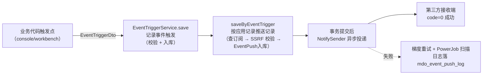

::: info 与「应用接入 · 事件回调」的分工

[应用接入 · 事件回调](../../integration/事件回调.md) 面向**第三方开发者**，讲怎么接收（报文格式、验签解密、应答约定）；本篇面向**平台方/二开工程师**，讲事件**怎么产生、怎么管理、没推送怎么排查、如何新增一种事件**。推送管道（重试/加密/线程池）的配置细节见[应用审核与授权 §5](应用审核与授权.md)。

:::

## 1. 事件体系总览



涉及 5 张表：`mdo_event_type`（类型）→ `mdo_event_subscription`（订阅）→ `mdo_event_trigger`（触发记录）→ `mdo_event_push`（推送任务）→ `mdo_event_push_log`（投递日志），字段见[表结构设计 §6](表结构设计.md)。

## 2. 新增一种事件

以内置的 `org:add` 为模板，新增事件固定四步：

**第 1 步：定义事件码常量**（`md-common-pojo` 的 `EventTypeCode.java:8-15`）

```java
interface Console {
    String ORG_ADD = "org:add";   // 冒号形式：{域}:{动作}
}
```

**第 2 步：登记事件类型**

`EventTriggerServiceImpl.save`（:35-49）按 `eventCode` 查 `mdo_event_type`，**不存在则断言失败、事件直接丢弃**。

登记方式：运营在「控制台」-「事件管理」页面维护。


**第 3 步：业务代码埋触发点**

在业务写完库的位置组 `EventTriggerDto` 调 facade（示例：`OrgServiceImpl.saveAfter`，`OrgServiceImpl.java:195-201`）：

```java
@Override
protected void saveAfter(Object save, Org entity) {
    EventTriggerDto request = new EventTriggerDto();
    request.setEventCode(EventTypeCode.Console.ORG_ADD)
            .setEventContent(IdDto.builder().id(entity.getId()).build().toString())
            .setTriggerAt(LocalDateTime.now());
    notifyAndEventPushFacade.eventPush(request);
}
```

**第 4 步：告知第三方 bizContent 结构**

事件内容结构由触发方自定义，平台不约束——**必须在接入文档中写清楚**，否则第三方无法解析。

::: warning eventContent 有 255 字符上限

`EventTriggerDto.eventContent` 带 `@Size(max = 255)`——**事件内容只放主键等少量标识**（内置事件全部只传 `{"id":...}`），第三方收到后用自己的凭证调开放接口回调查详情。想推完整快照需先扩该约束并评估推送报文体积。

:::

## 3. 触发通道：单体与微服务

| 部署形态 | 通道 | 说明 |
| ---- | ---- | ---- |
| 单体（boot） | 本地直接注入 `EventTriggerService` 调用 | open-boot-impl 本地实现 |
| 微服务（cloud） | Feign 远程调用 `/inner/eventTrigger/save`（`InnerEventTriggerController.java:22,29`） | open-cloud-impl 经内部调用到 open-server |

对业务代码**透明**——都调 `NotifyAndEventPushFacade.eventPush(EventTriggerDto)`，返回 `R<EventTrigger>`。根据部署形态，由服务层决定引入 xxx-boot-impl 还是 xxx-cloud-impl 。

| 方法 | 用途 | 触发方示例 |
| ---- | ---- | ---- |
| `eventPush(EventTriggerDto)` | 事件推送（一对多，按订阅遍历推送） | 组织/用户增删改 |
| `apiCallNotify(NotifyInfoDto)` | 接口回调（一对一，回给调用方） | 开放接口实现里（见[接口开发与发布 §5](接口开发与发布.md)） |

## 4. 订阅匹配与任务生成

`saveByEventTrigger`（`EventPushServiceImpl.java:56-110`）的关键行为，二开定制前必读：

1. **查订阅了该事件的所有应用**：`findByEventCode` 三表 join，条件 = 订阅了该事件 **且 `notify_state=true`** **且应用 `state=true`**（`EventSubscriptionServiceImpl.java:56-73`）；
2. **SSRF 逐个校验**：回调地址为空或非法（禁内网/回环）的订阅方**跳过并记 warn 日志，不阻断其他订阅方、不回滚事务**（:64-79）；
3. **配置快照**：任务的 `notifyUrl`、加密相关字段从 `mdo_app_keys` 冗余到当前推送表——之后改配置不影响已生成任务；
4. **异步投递**：事务提交后（afterCommit）才提交线程池投递——业务回滚不会产生幽灵推送。

## 5. 报文与加密

- 明文 JSON 固定结构：`type=EVENT_PUSH`、`method=事件码`、`appKey`、`timestamp`、`eventTriggerId`、`bizContent`（`EventPushTaskView.buildPlaintext`，:63-72）；
- **`bizContent` 是 JSON 字符串**（不是对象）——值即触发时传入的 `eventContent`，接收端取出后需二次解析；
- 三种加密类型、URL 验签参数、密钥派生等报文细节见[应用接入 · 事件回调 §4](../../integration/事件回调.md)（第三方按该文档解密，平台侧改动加密逻辑时必须同步该文档与 SDK 的 `MdpBizMsgCrypt`）；
- 回调成功的判定条件为： HTTP 200 且响应体 `code=0`（`NotifySender.java:67-85`）。

## 6. 重试与人工干预

| 机制 | 实现 |
| ---- | ---- |
| 梯度重试 | `mdp.notify.time-level` 默认 `2m,5m,30m,6h,12h`（最多 5 次），失败时递增 `nextRequestTime` |
| 定时扫描 | PowerJob 触发 `EventPushServiceImpl.retry`（:139-163），扫描「到期失败」+「超 5 分钟待执行丢失」两类 |
| 状态机 | `0`-待执行 → `1`-成功 / `2`-失败 → `3`-重试结束 / `4`-手动结束；终态幂等跳过 |
| 人工干预 | 控制台 `/admin/eventPush`：手动 `end`（:113 结束任务）、`executeImmediately`（:123 立即重推） |
| 投递日志 | 每次投递一条 `mdo_event_push_log`（请求体/响应体/错误原因） |

## 7. 排障手册

| 现象 | 排查路径 |
| ---- | ---- |
| 事件根本没产生触发记录 | 查业务触发点日志；`mdo_event_type` 是否登记了该事件码（未登记会断言失败）——这是最常见原因 |
| 有触发记录、无任何推送任务 | `mdo_event_subscription` 有无订阅；订阅应用的 `notify_state`、`mdo_app.state`；open-server 日志里「订阅该事件的应用数量：0」或 SSRF 跳过的 warn |
| 有任务但第三方没收到 | 任务 `exec_status` 与 `mdo_event_push_log` 的 `error_msg`（DNS/超时/对端 4xx/5xx）；对端是否返回了 `code=0` |
| 推送一直重试 | 第三方应答格式不符（成功判定只认 `code=0`）；对端处理超时（默认 5 秒，`mdp.notify.timeout`） |
| 改了回调配置仍发旧地址 | 任务创建时做了配置快照——新配置只影响新任务，旧任务可手动 `end` 后重新触发 |

## 8. 二开建议

| 想做什么 | 推荐做法 |
| ---- | ---- |
| 新增事件类型 | 按 §2 四步走；事件码用冒号形式 `{域}:{动作}`，加进 `EventTypeCode` 常量集中管理 |
| 推送失败告警 | 查 `exec_status=3`（重试结束）的任务接站内信/邮件，或覆写 `NotifyTaskExecutor` 的终态钩子 |
| 改重试策略 | 只调 `mdp.notify.time-level` 配置即可，无需改代码 |
| 推完整数据快照 | 先扩 `EventTriggerDto` 的 255 字符约束与 `mdo_event_trigger.event_content` 列宽，并评估报文加密后体积；多数场景仍推荐「id + 回调查详情」模式 |
| 事件溯源审计 | `mdo_event_trigger` + `mdo_event_push(Log)` 已是完整链路，直接做报表即可 |
