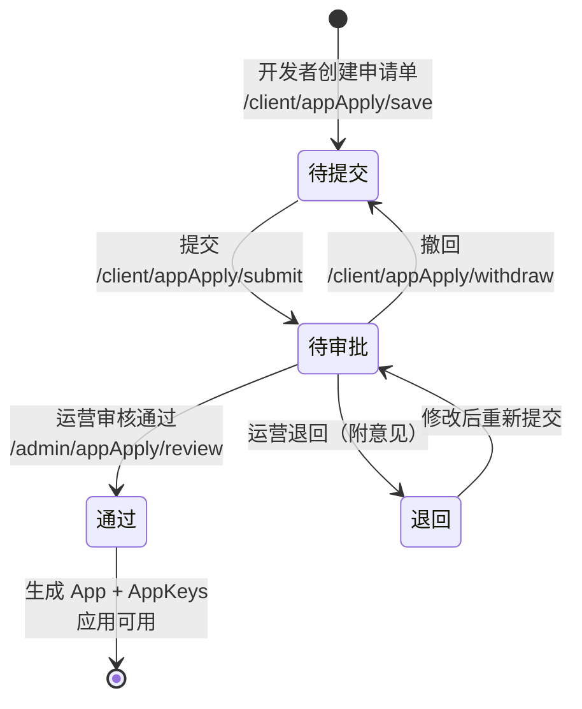
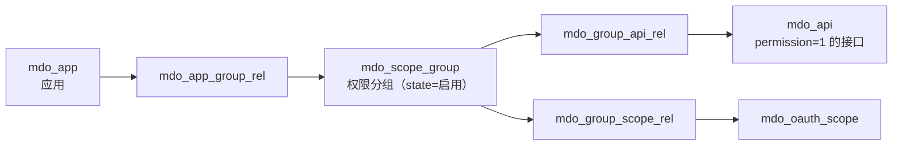
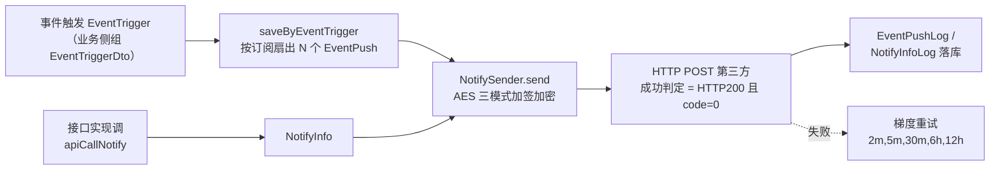

本篇覆盖开放平台管理侧的全部运营动作：**应用入驻审核、密钥管理、接口权限授权、OAuth2 scope 签约、事件订阅配置与推送管道**。每个动作都给出代码落点，方便二开时定制（如接企业自己的审批流）。

## 1. 应用生命周期

状态字段 `mdo_app_apply.audit_status`：`0`-待提交，`1`-待审批，`2`-通过，`99`-退回（`AuditStatusEnum`）。

### 1.1 开发者侧（web-open 开发者中心）

接口前缀 `/client/appApply`（`ClientAppApplyController.java:39`）：`save`、`submit`（:55）、`withdraw`（:63）、`update`、`delete`、`page`。

- `submit` → `AppApplyServiceImpl.submit`（:54）：置 `audit_status=1`、记 `submission_at`；
- `withdraw`（:92）：置回 `0`。

### 1.2 运营审核（console）

入口 `/admin/appApply/review`（`AppApplyController.java:83`）→ `AppApplyServiceImpl.review`（:102）：

**通过**（`approve=true`）时依次：

1. 校验当前状态必须是待审批/退回（:105），且未重复审核（:110）；
2. 申请单拷贝为 `App`（:113），复制 logo/资质附件（:116-119）；
3. **生成凭证**：`appKey = yyyyMMdd + 随机10位`（:123）、`appSecret = 随机36位`（:128）；
4. 保存 App（:129）并插入 `AppKeys` 记录（:131-133）；
5. 回写 `audit_status=2`、`review_comments`、`audit_at`（:137-142）。

**退回**：置 `99` + 审核意见（:144-149）。

::: warning 审核通过 ≠ 可调接口

审核通过后**不会自动分配任何权限分组**（无 `AppGroupRel` 写入）。应用此时只能调 `permission=0` 的公开接口；调用需授权接口前，运营还必须执行第 3 节的授权动作。

:::

运营也可以跳过申请流直接建应用：`/admin/app/save`（`AppController.java:60`）→ `AppServiceImpl.saveBefore`（:213-223）生成凭证、`saveAfter`（:236-241）插 AppKeys。

## 2. 密钥管理

| 动作 | 接口 | 实现 |
| ---- | ---- | ---- |
| 查看密钥 | `/admin/app/getKeys` | `AppController` |
| 重置 RSA 密钥对 | `/admin/app/updateKeys` | `AppKeysServiceImpl.resetAppKeys`（:175-184）：`RsaTool` 生成 PKCS8/2048 密钥对，**只把公钥存 `mdo_app_keys.public_key_app`，私钥返回给开发者自持，不下库** |
| 开发者上传公钥 | 开发者中心 `/client/app` | 开发者用 `RsaTool` 自生成密钥对（见 [SDK开发](SDK开发.md)），把公钥配到平台 |

其他安全边界：

- **应用级有效期**：`mdo_app.validity_start/end`，网关 `checkApp` 校验（`ApiValidator.java:258-278`）；
- **IP 白名单**：`mdo_app.allow_ip`；
- **OAuth2 token 超时**：应用级 `oauth2_*_token_timeout`（秒），**-1 表示读全局配置** `ConfigKey.Open.APP_CLIENT_TOKEN_TIMEOUT` 等（`OAuth2DataLoaderImpl.java:87-103`）。

## 3. 接口权限授权（scope 分组）

授权模型是「应用 → 权限分组 → 接口」的三表链（表结构见[表结构设计 §4](表结构设计.md)）：

运营配置三步（console）：

1. **建分组**：`/admin/scopeGroup`（`mdo_scope_group`）；
2. **分组关联接口**：`/admin/groupApiRel`（`GroupApiRelServiceImpl.saveDto/delete`，:38-86，**改完自动清 `AppApiCkBuilder` 缓存**）；
3. **授权给应用**：`/admin/app/saveAppGroup`（`AppGroupRelServiceImpl.saveDto` 全删全插，:39-59）。

运行时判定：网关 `AppManagerImpl.hasPermission`（:75-92）三表 join 取应用可访问 apiId 列表，缓存在 `AppApiCkBuilder`；删除分组会级联删两张关联表（`ScopeGroupServiceImpl.java:69-77`）。

## 4. OAuth2 scope 签约

OAuth2 模式下，应用能申请哪些 scope 同样由分组决定：

- `mdo_oauth_scope.level`：`1`-公开，`2`-特殊（**特殊权限必须填 `apply_prompt` 申请提示语**，`OauthScopeServiceImpl.java:50-61`）；
- 应用可签 scope = 应用所属分组的 `GroupScopeRel` 关联的公开 scope（`OauthScopeMapper.selectByAppId`，`OauthScopeServiceImpl.java:90-93`）；
- 颁发 token 时，workbench 的 `OAuth2DataLoaderImpl.getClientModel`（:46-110）经 `OauthScopeFacade.listByAppId` 加载签约 scopes 放入 `SaClientModel.addContractScopes`，由 sa-token OAuth2 校验请求 scope 是否越权。

## 5. 事件订阅与推送配置

### 5.1 开发者配置回调（web-open）

`/client/app/updateEventSubscription`（`AppKeysServiceImpl.updateEventSubscription` :155-159）维护 `mdo_app_keys` 的推送配置：

| 字段 | 说明 |
| ---- | ---- |
| `notify_url` / `notify_state` | 推送地址 / 开关（订阅判定时要求 `notify_state=true`） |
| `notify_encryption_type` | `0`-明文，`1`-兼容（明文+密文双份），`2`-安全（仅密文） |
| `notify_token` / `notify_encoding_aes_key` | 签名令牌 / AES 密钥（43 字符） |

平台提供生成工具：`MdpBizMsgCrypt.generateEncodingAesKey()`（43 字符，:298-302）、`generateToken()`（32 字符，:305-307）。

::: tip 回调地址没有 echostr 验证

`MdpBizMsgCrypt.verifyUrl`（类微信的 echostr 校验）在平台侧**没有调用方**——当前回调地址合法性由 `NotifyUrlValidator` 的 SSRF 校验保证（仅允许 http/https、解析 IP 禁内网/回环，`NotifyUrlValidator.java:26-62`；`mdp.notify.allowed-hosts` 白名单仅供本地联调）。二开如需「保存前先验证地址可用」，可以复用 `verifyUrl` 自行实现。

:::

订阅事件：开发者按事件类型订阅（`mdo_event_subscription`，事件码如 `org:add`/`user:edit`，常量 `EventTypeCode`）。

### 5.2 推送管道（平台 → 第三方）

事件推送与接口回调共用同一条投递管道：

关键事实：

- **报文**：明文 JSON 含 `type`（`EVENT_PUSH`/`CALLBACK`）、`method`（事件码/接口名）、`appKey`、`timestamp`、`bizContent`；加密模式经 URL 参数 `signature/msgSignature/timestamp/nonce/encryptType` 传递（`MdpBizMsgCrypt.encryptMsg`）；
- **投递**：Hutool HTTP POST，超时 `mdp.notify.timeout`（默认 5000ms），事务提交后异步投递（afterCommit）；
- **重试**：梯度 `mdp.notify.timeLevel`（默认 `2m,5m,30m,6h,12h`，即最多 5 次），PowerJob 定时扫描「到期失败 + 超 5 分钟待执行丢失」两类任务（`NotifyInfoServiceImpl.java:113-137`）；
- **线程池**：core 8 / max 16 / queue 500，AbortPolicy 满则留待重试扫描兜底（`NotifyProperties.java:41-45`）；
- **人工干预**：`/admin/eventPush` 支持手动 `end`（结束任务）与 `executeImmediately`（立即执行）。

运营排障入口：`/admin/eventPush(Log)`、`/admin/notifyInfo(Log)`、`/admin/apiCallLog` 查推送与调用日志。

## 6. 全局配置速查

**系统参数**（`ConfigKey.Open`，`ConfigKey.java:63-98`，在控制台系统参数中维护）：

| key | 说明 |
| ---- | ---- |
| `TornaServerAddr` | Torna 服务器地址（文档同步/查看依赖） |
| `OpenProdUrl` / `OpenSandboxUrl` | 开发者平台生产/测试地址（文档页回显） |
| `AppClientTokenTimeout` / `AppLowerClientTokenTimeout` | 默认 Client-Token 有效期（秒） |
| `AppAccessTokenTimeout` / `AppRefreshTokenTimeout` | 默认 Access/Refresh-Token 有效期（秒） |
| `AppNewRefresh` | RefreshToken 刷新策略（true=每次换新） |

**推送管道配置**（`NotifyProperties`，前缀 `mdp.notify`）：

| 配置 | 默认值 | 说明 |
| ---- | ---- | ---- |
| `mdp.notify.timeout` | 5000 | 推送 HTTP 超时（毫秒） |
| `mdp.notify.time-level` | `2m,5m,30m,6h,12h` | 重试梯度（级数=最大重试次数） |
| `mdp.notify.allowed-hosts` | — | 推送地址白名单（**仅供本地联调**，生产禁用） |
| 线程池 | core 8 / max 16 / queue 500 | 投递线程池参数 |

## 7. 二开定制建议

| 想做什么 | 推荐做法 |
| ---- | ---- |
| 接企业审批流 | 在 `AppApplyServiceImpl.submit/review` 前后加钩子（或改为调外部 BPM），保持状态机不变 |
| 审核通过自动授权默认分组 | 在 `review` 的通过分支（:129 之后）追加 `AppGroupRel` 写入，注意清 `AppApiCkBuilder` 缓存 |
| 自定义 appKey 生成规则 | 改 `AppServiceImpl.saveBefore`（:217）与 `AppApplyServiceImpl.review`（:123）**两处**，保持一致 |
| 推送失败告警 | 监听重试结束（`exec_status=3`）的任务，接站内信/邮件 |
| 回调地址可用性验证 | 复用 `MdpBizMsgCrypt.verifyUrl` 实现类微信的 echostr 校验（当前未启用） |
