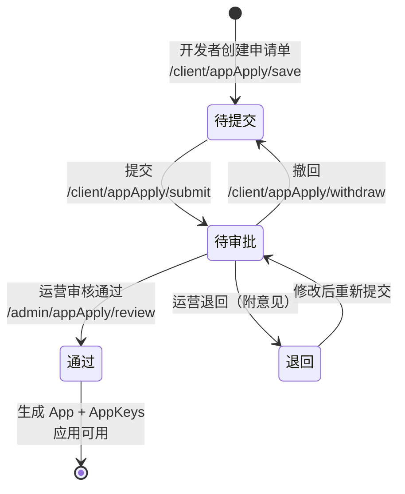

开放平台提供两条应用入驻与授权路径，本篇按角色把两条路径讲透：

- **申请-审批流**（开发者自助申请）：开发者在 web-open 申请应用（§2）→ 申请权限组（§3）→ 运营在 web-console 审批应用（§4）→ 审批权限组（§5）；
- **运营直管流**（后台直接创建）：运营直接在 web-console 创建应用（§6）→ 直接分配权限组（§7）。

每个动作都给出前后端代码落点，方便二开时定制（如接企业自己的审批流）。

## 1. 应用申请生命周期

状态字段 `mdo_app_apply.audit_status`（`AuditStatusEnum`）：`0`-待提交，`1`-待审批，`2`-通过，`3`-已撤销，`99`-退回。权限组申请单（`mdo_app_scope_apply`）复用同一枚举。

## 2. 开发者：申请应用

页面：web-open 开发者中心「应用申请」。

**列表操作与状态约束**（`web-open/.../client/appApply/data/index.tsx:131-159`）：

| 操作 | 可见条件 | 接口 |
| ---- | ---- | ---- |
| 新增 | 总是 | `POST /client/appApply/save`（存草稿，状态 0） |
| 提交 | 弹窗内「提交」按钮 | `POST /client/appApply/submit`（置 1，记 `submission_at`） |
| 编辑 | 仅待提交 / 退回 | `POST /client/appApply/update` |
| 撤回 | 仅待审批 | `POST /client/appApply/withdraw`（置回 0） |
| 删除 | 仅待提交 / 退回 | `POST /client/appApply/delete` |
| 查看 | 总是 | 只读弹窗，含审核信息区 |

**申请表单字段**（`data/form.tsx:24-197`）：应用名称、应用简介、首页地址、应用图标（图片上传）、资质文件（分片上传，最多 10 个）、备注。

服务端：`ClientAppApplyController`（前缀 `/client/appApply`）；`submit` → `AppApplyServiceImpl.submit`（:54）、`withdraw`（:92）。

## 3. 开发者：申请应用权限

应用创建成功（审批通过或运营直建）后，默认**没有任何权限组**，只能调 `permission=0` 的公开接口。调用受限接口前，需在 web-open「应用管理」→ 应用详情 → **权限** Tab 申请（`client/app/modules/scope.vue`）：

| Tab | 内容 |
| ---- | ---- |
| 已有权限 | 已生效的权限组卡片（绿色「已生效」标记），数据来自 `GET /client/scopeGroup/listOwned` |
| 可申请权限 | 可勾选的权限组卡片（`GET /client/scopeGroup/listAppliable`），每张卡可打开「组详情」查看组内含哪些开放接口与 OAuth2 权限（`GET /client/scopeGroup/getGroupDetail`） |
| 申请记录 | 历史申请单（权限组/审核状态/审核意见/时间），可撤销、删除 |

**申请动作**：勾选权限组（至少一个）+ 填写申请理由（必填，≤512 字）→ `POST /client/appScopeApply/apply`，参数 `{appId, groupIds[], applyReason}`，**一单一组、批量生成**（`ClientAppScopeApplyController.java:60`）。

服务端校验（`AppScopeApplyServiceImpl.apply`，:46-82，fail fast）：

1. **归属**：只能为本人创建的应用申请；
2. 权限组存在且 `state=启用`；
3. **未拥有**该权限组（防重复申请）；
4. 该组**无待审批**的申请单（防重复提交）。

**申请记录操作**：撤销（仅待审批，置 `3`-已撤销）、删除（仅已撤销）。

## 4. 运营：审批应用

页面：web-console 控制台「开放平台 → 应用 → 应用审核」（路由 `/manage/appApply`）。

- 列表展示申请单（名称/主页/提交时间/审核状态/审核时间），行操作：查看、**审核**（仅待审批出现）、删除；
- 审核弹窗（`admin/appApply/data/review.tsx:24-61`）：审核结果（通过/退回，默认通过）+ 审核意见（**退回时必填**）→ `POST /admin/appApply/review`。

**通过**时服务端依次执行（`AppApplyServiceImpl.review`，:102 起）：

1. 校验当前状态必须是待审批/退回（:105），且未重复审核（:110）；
2. 申请单拷贝为 `App`（:113），复制 logo 附件（:116-119，资质文件不复制）；
3. **生成凭证**：`appKey = yyyyMMdd + 随机10位`（:123）、`appSecret = 随机36位`（:128）——appKey 全程由后端生成，前端无自填入口；
4. 保存 App（:129）并插入 `AppKeys` 记录（:131-133）；
5. 回写 `audit_status=2`、`review_comments`、`audit_at`（:137-142）。

**退回**：置 `99` + 审核意见（:144-149）。

::: warning 审批通过 ≠ 拥有接口权限

应用审批通过只完成「入驻」——此时应用没有任何权限组。开发者还需按 §3 申请权限组、运营按 §5 审批（或由运营按 §7 直接分配），应用才能调 `permission=1` 的受限接口。

:::

## 5. 运营：审批应用权限

页面：web-console 控制台「开放平台 → 权限申请审核」（路由 `/manage/appScopeApply`，菜单 SQL 见 `mdp.sql:1400`）。

- 列表列：应用名称、权限组名称、申请理由、审核状态、申请/审核时间、审核意见；支持按应用、权限组、状态、时间筛选；
- 行操作「组详情」：审批前查看该权限组包含的开放接口与 OAuth2 权限明细（复用 `ScopeGroupDetailModal`，`GET /admin/scopeGroup/getGroupDetail`）——**先看清要给出去什么权限，再决定批不批**；
- 审核弹窗：通过/退回（退回必填意见）→ `POST /admin/appScopeApply/review`。

**通过**时（`AppScopeApplyServiceImpl.review`，:86-109）：

1. 校验申请单存在且为待审批（防并发重复审核）；
2. **幂等写入授权关系**：`mdo_app_group_rel` 已存在该「应用+分组」则跳过，否则插入；
3. 回写 `audit_status=2`、审核意见、审核时间。

**退回**：意见必填，置 `99`。

::: tip 审批通过后的缓存时效

权限审批通过的 `AppGroupRel` 写入走的是单条 `save`，**没有**像直接分配（§7）那样显式清 `AppApiCkBuilder` 缓存——授权生效依赖缓存自然过期。若第三方反馈「审批通过了还是报 `ISV_ROUTE_NO_PERMISSIONS`」，先怀疑网关缓存未刷新。

:::

## 6. 运营：直接创建应用

页面：console「开放平台 → 应用 → 应用管理」（路由 `/manage/app`），工具栏「新增」→ `POST /admin/app/save`。适用于内部系统、替合作方代建等**不需要开发者走申请流**的场景。

表单字段（`admin/app/data/form.tsx:25-417`）：

| 分组 | 字段 |
| ---- | ---- |
| 基本信息 | 名称、图标、appKey（**禁用输入，占位「系统自动生成」**）、应用类型（自建/第三方）、状态、排序、简介、备注 |
| 开发配置 | 是否公开（任何人可登录 / 需授权）、是否显示、首页地址、IP 白名单（精确 IP / 通配符 `*` / CIDR 网段）、登录方式（ticket/OAuth2） |
| ticket 组 | 免登跳转地址、跳转地址白名单、是否接收推送、消息推送地址 |
| OAuth2 组 | 允许授权地址、授权模式、是否自动授权（静默/用户手动确认）、RefreshToken 刷新策略、4 项 token 有效期（**-1 = 读全局配置** `ConfigKey.Open.APP_*`） |

保存时 `AppServiceImpl.saveBefore`（:213-223）自动生成 appKey/appSecret，`saveAfter`（:236-241）插入 AppKeys——与审批通过走同一套生成规则。

::: info 表单没有「应用有效期」字段

`mdo_app.validity_start/end` 存在且网关 `checkApp` 会校验，但当前控制台表单未暴露该字段（语言包有词条未使用）。需要限制应用有效期时只能直接改库，或自行补表单字段——这是一个待完善的功能。

:::

## 7. 运营：直接分配权限

在「应用管理」列表行操作点**权限组**（`admin/app/modules/app-group.vue`）：弹窗内勾选权限组（回显 `GET /admin/app/listGroupIdByAppId`）→ 保存调 `POST /admin/app/saveAppGroup`。

保存逻辑（`AppGroupRelServiceImpl.saveDto`，:39-59）：**全删全插**该应用的分组关系，并显式清除网关授权缓存 `AppApiCkBuilder`——直接分配**立即生效**。

**前置：权限分组的维护**（console「开放平台 → 权限 → 权限组」，路由 `/manage/group`）。分配之前分组本身要建好并配置内容，页面为左右分栏：

1. 左栏建分组：名称、简介、排序、状态（`POST /admin/scopeGroup/save`）；
2. 右栏「开放接口」Tab 点**配置接口**：从「该组未拥有的接口」中勾选 → `POST /admin/groupApiRel/save`（改完自动清 `AppApiCkBuilder` 缓存）；
3. 右栏「Oauth2权限」Tab 点**配置权限**：同理 → `POST /admin/groupScopeRel/save`。

运行时判定链（应用 → 分组 → 接口 三表 join）与缓存机制见[接口开发与发布 §4](接口开发与发布.md)；删除分组会级联删两张关联表（`ScopeGroupServiceImpl.removeByIds`，:84-93）。

## 8. 密钥与回调配置

### 8.1 开发者自助（web-open「应用管理」→ 详情）

::: tabs

@tab 应用秘钥

@tab 事件订阅

@tab 开发配置

:::

| Tab | 内容 | 接口 |
| ---- | ---- | ---- |
| 应用秘钥 | 查看 appKey/appSecret；维护开发者 RSA 公钥 `publicKeyApp`；「替我生成公私钥」（弹确认：旧密钥对将失效）只读展示新密钥对，**私钥仅此一次展示、平台不下库** | `POST /client/app/resetAppKeys`、`POST /client/app/updateKeys` |
| 事件订阅 | 通知开关、通知地址、加密三模式、签名令牌与 AES 密钥（均可随机生成）、订阅事件类型 | `POST /client/app/updateEventSubscription` |
| 开发配置 | 是否公开、IP 白名单、ticket/OAuth2 参数（字段同 §6 的开发配置组） | `POST /client/app/updateDev` |

### 8.2 运营代管（console「应用管理」行操作「密钥」）

`GET /admin/app/getKeys` 查看、`POST /admin/app/updateKeys` 修改通知地址/加密模式/Token/EncodingAESKey 等；`AppKeysServiceImpl.resetAppKeys`（:175-184）重置 RSA 密钥对时**只把公钥存 `mdo_app_keys.public_key_app`，私钥返回给开发者自持**。

事件推送管道（重试/加密/排障）见[事件回调](事件回调.md)。

## 9. OAuth2 scope 签约

OAuth2 模式下应用能申请哪些 scope 同样由权限组决定：

- `mdo_oauth_scope.level`：`1`-公开，`2`-特殊（**特殊权限必须填 `apply_prompt` 申请提示语**，`OauthScopeServiceImpl.java:50-61`），维护入口 console「权限 → Oauth2权限」；
- 应用可签 scope = 应用所属分组的 `GroupScopeRel` 关联的公开 scope（`OauthScopeServiceImpl.java:90-93`）；
- 颁发 token 时 `OAuth2DataLoaderImpl.getClientModel`（:46-110）经 `OauthScopeFacade.listByAppId` 加载签约 scopes 放入 `SaClientModel.addContractScopes`，由 sa-token OAuth2 校验请求 scope 是否越权。

## 10. 全局配置速查

**系统参数**（`ConfigKey.Open`，`ConfigKey.java:63-98`，在控制台系统参数中维护）：

| key | 说明 |
| ---- | ---- |
| `TornaServerAddr` | Torna 服务器地址（文档同步/查看依赖） |
| `OpenProdUrl` / `OpenSandboxUrl` | 开发者平台生产/测试地址（文档页回显） |
| `AppClientTokenTimeout` / `AppLowerClientTokenTimeout` | 默认 Client-Token 有效期（秒） |
| `AppAccessTokenTimeout` / `AppRefreshTokenTimeout` | 默认 Access/Refresh-Token 有效期（秒） |
| `AppNewRefresh` | RefreshToken 刷新策略（true=每次换新） |

**推送管道配置**（`NotifyProperties`，前缀 `mdp.notify`）：

| 配置 | 默认值 | 说明 |
| ---- | ---- | ---- |
| `mdp.notify.timeout` | 5000 | 推送 HTTP 超时（毫秒） |
| `mdp.notify.time-level` | `2m,5m,30m,6h,12h` | 重试梯度。实际口径：总投递 5 次（首次+4 次重试），只用到前 4 档间隔，第 5 档不触发（详见[事件回调 §6](事件回调.md)） |
| `mdp.notify.allowed-hosts` | — | 推送地址白名单（**仅供本地联调**，生产禁用） |
| 线程池 | core 8 / max 16 / queue 500 | 投递线程池参数 |

## 11. 二开定制建议

| 想做什么 | 推荐做法 |
| ---- | ---- |
| 接企业审批流 | 在 `AppApplyServiceImpl.review` / `AppScopeApplyServiceImpl.review` 前后加钩子（或改为调外部 BPM），保持状态机不变 |
| 应用审批通过自动分配默认权限组 | 在 `review` 通过分支（`AppApplyServiceImpl.java:129` 之后）追加 `AppGroupRel` 写入，注意清 `AppApiCkBuilder` 缓存 |
| 权限审批通过立即生效 | 在 `AppScopeApplyServiceImpl.review` 写 `AppGroupRel` 后补 `cacheOps.del(AppApiCkBuilder...)`（对齐 `saveDto` 的做法） |
| 自定义 appKey 生成规则 | 改 `AppServiceImpl.saveBefore`（:217）与 `AppApplyServiceImpl.review`（:123）**两处**，保持一致 |
| 应用有效期管理 | 给控制台应用表单补 `validityStart/validityEnd` 字段（语言包词条已有） |
| 回调地址可用性验证 | 复用 `MdpBizMsgCrypt.verifyUrl` 实现类微信的 echostr 校验（当前未启用，仅有 SSRF 校验） |
