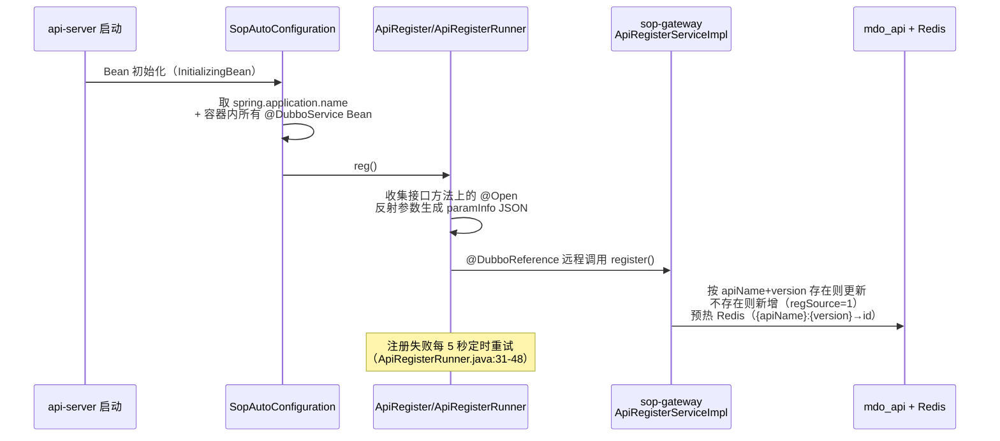
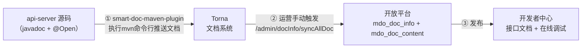
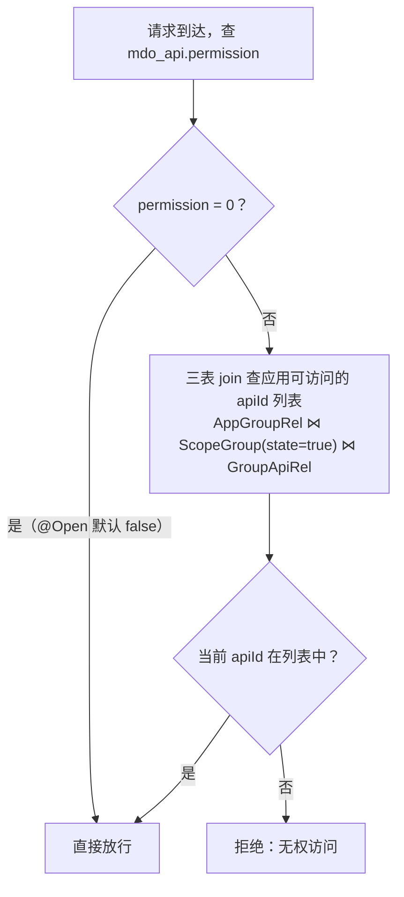

本篇走完一个开放接口的完整生命周期：**写接口 → 自动注册 → 生成文档 → 同步发布 → 配置权限**。以平台已有的 `user.page` 接口为示例。

## 1. 开发开放接口

### 1.1 编写接口

**第 1 步：定义出入参**（`md-api/api-pojo` 模块，`top.mddata.api.dto/resp/query` 包）

```java
// top.mddata.api.query.UserQuery —— 查询条件
// top.mddata.api.resp.UserResp  —— 返回对象
// 均为普通 POJO（Serializable），字段名即 bizContent JSON 的字段名
```

**第 2 步：声明接口**（`md-api/api-service` 模块，`top.mddata.api` 包）

`@Open` 标注在 **Service 接口的方法**上

```java
// 可自己决定是否继承SuperService
public interface UserOpenService extends SuperService<User> {

    @Open(value = "user.page", description = "分页查询用户信息")
    Page<UserResp> page(PageParams<UserQuery> params);
}
```

**第 3 步：实现并暴露**

```java
@DubboService          // 暴露为 Dubbo 服务，网关泛化调用的目标
@Service
public class UserOpenServiceImpl extends SuperServiceImpl<UserMapper, User>
        implements UserOpenService {
    @Override
    public Page<UserResp> page(PageParams<UserQuery> params) { ... }
}
```

先启动注册中心和sop-gateway，然后重启 api-server（单体版为 worker-server），接口自动注册进开放平台，无需任何手工登记。

### 1.2 @Open 属性

定义见 `md-sop-support/sop-service-support/.../annotation/Open.java:17`：

| 属性 | 默认值 | 说明 |
| ---- | ---- | ---- |
| `value` | — | 接口名（如 `user.page`），**即请求公共参数 `method` 的值，发布后不可改** |
| `description` | `""` | 接口中文描述，注册时写入 `mdo_api.description`（javadoc 运行时反射不到，必须显式写在这里） |
| `version` | `"1.0"` | 版本号，升级接口时递增 |
| `permission` | `false` | 是否需要授权。`true` 时应用必须被分到包含该接口的权限分组才能调用 |
| `needToken` | `true` | 是否要求 accessToken（网关先验非空，拦截器再验有效性） |
| `needSign` | `false` | 是否强制 RSA2 验签（`accessToken.get` 这类高安全接口应开） |
| `hasCommonResponse` | `true` | 是否包公共响应壳（`code/msg/subCode/subMsg/data`）；`false` 只返回 data |

## 2. 接口自动注册链路

接口不需要人工登记，启动即注册：



关键代码位置：

| 环节 | 类 | 说明 |
| ---- | ---- | ---- |
| 触发点 | `SopAutoConfiguration.java:42-51` | `InitializingBean.afterPropertiesSet`，装配条件 `dubbo.enabled`（默认 true） |
| 注册器 | `ApiRegister.java:85-138` | 只处理实现接口的 `@DubboService` 类，从接口方法收集 `@Open`；`buildRegisterDTO`（:140-193）反射生成参数 JSON |
| 重试 | `ApiRegisterRunner.java:31-48` | 失败后每 5 秒重试（主要是为了解决网关没有启动） |
| 网关接收 | `ApiRegisterServiceImpl.java:46-59` | `@DubboService` 暴露；`appName` 全局唯一校验（:61-65）；`saveOrUpdate` 同时预热 Redis |

::: tip 注册不进去怎么排查

1. api-server 日志里有没有 Dubbo 注册中心连接失败的异常（重试日志每 5 秒一条）；
2. 接口是否标在 **Service 接口**的方法上（标在 impl 类上也能收集，但接口必须存在——`ApiRegister` 只处理实现接口的类）；
3. `mdo_api` 表里 `app_name` 是否被别的服务占用（全局唯一）。

:::

## 3. 识别接口注释-生成文档：生成 → 推送 → 同步 → 发布

接口注册只写 `mdo_api`，**不产生文档**。文档是一条独立的两段链路：



### 3.1 生成并推送到 Torna（二开工程师侧）

- 部署Torna 2.1.x 

  详细安装请参考： [https://torna.cn/tutorial/start.html#%E9%83%A8%E7%BD%B2torna](https://torna.cn/tutorial/start.html#部署torna)

  1. 安装jdk、mysql 
  2. [前往下载](https://gitee.com/durcframework/torna/releases)最新版，zip格式压缩包
  3. 导入数据库，执行[mysql.sql](https://gitee.com/durcframework/torna/blob/master/mysql.sql)
  4. 打开 application.properties 配置文件，修改数据库连接配置，修改端口号为 27700
  5. linux 执行 sh startup.sh 启动
  6. Windows 执行 startup.bat 启动
  7. 访问：`http://<服务器ip>:27700` 用户名：admin，密码：123456

- 配置Torna

  安装完毕后登录Torna后台，创建一个空间，在空间下创建一个项目，如：开放平台

  

  进入项目，创建一个应用，一个应用对应一个微服务工程。 
  然后点击OpenAPl，会看到一个请求路径和token，这个后面会用到。

  	

- 文档模板：`SopDocBuildTemplate`，smart-doc 的扩展类。可以根据自己的需求修改该类源码。

- 推送配置：`md-api/api-server/src/main/resources/smart-doc.json`

  ```json
  {
    "framework": "sop",       													 // 固定填：sop
    "outPath": "target/doc",													   // 固定填
    "projectName": "开放接口",														// 项目名称
    "packageFilters": "top.mddata.api.*",                // 存放@Open注解的包路径。 若包路径配置错误，无法扫描到文档
    "openUrl": "http://localhost:27700/api",             // torna 服务的地址。 （默认的端口是7700，需要自己调整）
    "appToken": "0288dabf1a024153adf473b57ea15038",      // Torna 空间的 open token
    "debugEnvName": "本地环境",
    "debugEnvUrl": "http://127.0.0.1:23456",
    "tornaDebug": true,																	 // 是否开启调试，初次使用建议开始，后面稳定了关闭
    "replace": true,																		 // 是否替换文档，建议true
    "showValidation": false															 // 显示校验信息，建议false	
  }
  ```

- [开发接口](#_1-开发一个开放接口)：在api-service服务开发接口

- 在 `mdp-apps/md-api/pom.xml` 中添加插件

  ```xml
  <build>
      <plugins>
          <!-- 文档推送 -->
          <plugin>
              <groupId>com.ly.smart-doc</groupId>
              <artifactId>smart-doc-maven-plugin</artifactId>
              <version>${smart-doc.version}</version>
              <configuration>
                  <!--指定生成文档的使用的配置文件-->
                  <configFile>./src/main/resources/smart-doc.json</configFile>
                  <!--指定项目名称-->
                  <projectName>${project.artifactId}</projectName>
              </configuration>
              <dependencies>
                  <dependency>
                      <groupId>top.mddata.base</groupId>
                      <artifactId>sop-service-support</artifactId>
                      <version>${mdp-base.version}</version>
                  </dependency>
              </dependencies>
          </plugin>
      </plugins>
  </build>
  ```

  对应关系如下图所示：

	

- 执行mvn命令推送文档：在 `api-server` 目录下运行 `mvn smart-doc:torna-rpc`（插件声明在 `md-api/pom.xml:28-40`，`configFile` 为相对路径 `./src/main/resources/smart-doc.json`，因此必须在 api-server 目录执行），文档即推送到 Torna。

  - 每次修改接口、注释后，在 `mdp`项目根目录编译项目，将所有源码安装到 本地仓库

    ```shell
    mvn clean install 	
    ```

  - 在 `mdp-apps/md-api` 目录执行命令

    ```shell
    mvn smart-doc:torna-rpc -pl :api-server -am -f pom.xml
    ```


- 验证文档是否推送成功

  访问Torna管理后台：http://localhost:27700/ ，==将所有状态为进行中的文档修改为已完成==

  

::: warning Torna 需要独立部署

Torna 是外部文档系统，不包含在 MDP 项目中。地址配置在系统参数 `ConfigKey.Open.TORNA_SERVER_ADDR`（`ConfigKey.java:68`），开放平台的同步、文档查看页都依赖它。

:::

### 3.2 将文档从Torna同步回开放平台（运营侧）

运营在控制台触发同步。同步逻辑（`DocInfoServiceImpl.syncDocInfo.java:148-219`）：用 `TornaClient` 调 Torna open API `doc.list` 拉文档列表，按 name+url+version 增改 `mdo_doc_info`；再逐个 `doc.details` 拉详情 JSON 存 `mdo_doc_content`（:274-303）。

**没有定时任务，纯手动触发**——接口文档更新后记得重新同步。

- 新增文档组

  

- 同步文档

  


### 3.3 发布与对外查看

- 发布：`updatePublish`发布/下线单个文档，**级联联动父节点与所属空间的 publish**；

  

- 查看：开发者中心 - 接口文档

  

- 在线调试：`OpenDocController` 的 `buildDebugParam` 按 mdp-sdk 的规则现场组装签名参数，开发者填自己的 appKey/私钥即可在文档页直接调接口。

  

## 4. 配置接口权限

接口权限解决的是「**哪个应用能调哪个开放接口**」，与面向平台用户的 [uri 接口权限](../接口权限.md) 「哪个用户能访问平台的哪个内部接口」是两套完全不相干的体系。请勿混为一谈！

判定逻辑（网关 `AppManagerImpl.hasPermission`，`AppManagerImpl.java:75-92`）：



配置动作（运营在控制台操作，详见[应用审核与授权](应用审核与授权.md)）：

1. 建权限分组（`mdo_scope_group`）；

   

2. 分组关联接口（`mdo_group_api_rel`，改完自动清 `AppApiCkBuilder` 缓存）；

   

3. 把分组授权给应用（`mdo_app_group_rel`，`/admin/app/saveAppGroup`）。

开发者亦可在开发者中心申请权限：

1. 权限申请
2. 权限审批

::: tip 二开建议

新接口默认 `permission=false`（公开给所有有凭证的应用）。涉及敏感主数据写操作的接口（如 `user.batchSave`）建议显式 `permission=true`，把授权决定权交给运营。

:::

## 5. 让接口支持异步回调

耗时接口（如批量导入）支持「先受理、后回调」：SDK 请求带 `notifyUrl` 参数，或提前在应用信息中配置**通知接口**。接口实现处理完后将触发回调任务：

```java
// 示例：OrgOpenServiceImpl.callNotify（OrgOpenServiceImpl.java:88-106）
notifyAndEventPushFacade.apiCallNotify(notifyInfoDto);
// notifyUrl 取自 OpenContext（即调用方请求表单里的 notifyUrl 参数）
```

回调任务的投递、加密、重试与事件推送共用一条管道，详见[事件回调（平台侧）](事件回调.md)；第三方接收端的写法见[接口回调](../../integration/接口回调.md)。

## 6. 二开注意事项

::: warning 接口名需谨慎修改

新开发的接口`@Open` 的 `value`/`version` 一旦对外发布，改值将导致所有第三方 SDK 全部失效。接口演进应遵循规则：

- 新增**可选**参数：可以直接加；
- 修改语义/删参数/改返回结构：可以新建一个全新入参实体，然后新增一个同名方法后升级 `version`（如 `2.0`），旧版本接口同步保留一段时间；
- SDK 侧同步新增 `XxxApi`（见 [SDK开发](SDK开发.md)），method 值两侧必须完全一致。

:::

::: warning 异常要抛 OpenException 

业务校验失败抛 `ArgumentException`（`GlobalExceptionFilter` 会包装成 `OpenException`，`GlobalExceptionFilter.java:19-36`），网关 `ExceptionExecutorImpl` 按 `<OPEN_ERROR>code@@msg@@solution` 格式解析成标准错误响应。直接抛 RuntimeException 会被包装成笼统的系统错误，第三方无法定位。

:::
