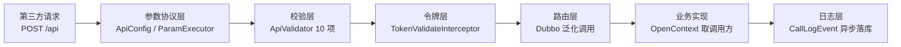
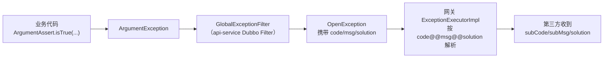

::: info 与「应用接入 · 接口调用」的分工

[应用接入 · 接口调用](../../integration/接口调用.md) 面向**第三方开发者**，讲怎么调（协议、签名、SDK 用法）；本篇面向**平台方/二开工程师**，讲请求进来之后**平台侧做了什么、怎么管理与排障、在哪里扩展**。网关各环节（10 项校验、验签、路由）的源码级拆解见[调用链路与扩展点](调用链路与扩展点.md)，本篇不复述，聚焦运行时管理面。

:::

## 1. 平台侧总览



## 2. 请求协议的平台侧定义

第三方看到的「公共参数协议」不是写死的，平台侧可配置：

| 配置 | 位置 | 说明 |
| ---- | ---- | ---- |
| 公共参数名 | `GateApiConfig`（继承 `ApiConfig`，`GateApiConfig.java:12-13`），前缀 `mdp.api.*` | `appKey`/`method`/`version`/`sign`/`bizContent` 等 11 个参数名全部可覆盖（默认值见 `ApiConfig.java:17-57`） |
| 请求超时 | `mdp.api.timeout-seconds`，默认 300 秒 | timestamp 与服务器时差超过即拒绝（`ApiValidator.checkTimeout`） |
| 网关入口路径 | `mdp.gateway.path`，默认 `/api` | `IndexController` 的 `@RequestMapping` |
| REST 入口路径 | `mdp.gateway.rest` | RESTful 简化入口 |
| 泛化调用超时 | `generic.timeout`，默认 5000ms | 网关 → api-server 的 Dubbo 泛化调用超时（`GenericServiceInvoker`） |
| 日期序列化格式 | `mdp.gateway.serialize.date-format` | 响应 JSON 的日期格式（`SerdeImpl`） |

::: warning 改参数名 = 改协议

`mdp.api.*` 改了参数名，所有第三方（含官方 mdp-sdk 默认配置）都会调不通。SDK 侧 `OpenConfig` 虽支持同名字段修改，但已交付的第三方不会同步改。**这套配置只在平台首次上线前定一次，之后就不能再乱改了**。

:::

## 3. accessToken 管理

颁发与校验的实现细节（`TokenOpenServiceImpl.java:47-106`）：

| 环节 | 机制 | 二开调整点 |
| ---- | ---- | ---- |
| 颁发 | `accessToken.get`（`needToken=false, needSign=true`）：appKey+appSecret+应用状态经 AppFacade 远程校验 | 校验逻辑在 `TokenOpenServiceImpl.get`（:50-60） |
| 生成 | 双 SHA-256 拼接生成 128 位 hex（:112-116） | 算法可换，注意同步 SDK |
| 存储 | Redis 双 key：`{appKey}:{token}`→appId（校验用）、`{appKey}`→token（复用判定用） | 结构在 `AccessTokenCkBuilder` |
| 有效期 | **固定 2 小时**（`AccessTokenCkBuilder.DEFAULT_EXPIRE`） | 调整需改该常量；注意与第三方文档同步 |
| 复用 | 非 `forceRefresh` 且有有效 token 直接返回旧值（:65-79） | — |
| 强制刷新 | `forceRefresh=true` 生成新 token 并废弃旧 token | — |
| 校验 | `TokenValidateInterceptor` 按 `{appKey}:{token}` 复合 key 反查 appId，**防跨应用冒用** | 拦截器可覆写 `match` 扩大/缩小范围 |

::: tip 为什么 token 与用户无关

这套 accessToken 是**应用级**令牌（appKey 维度），不携带用户身份——开放接口操作的是平台主数据，不代表某个用户。用户级令牌走 OAuth2 单点登录链路（`mdo_oauth_log`），两套体系不要混用。

:::

## 4. 业务实现中获取调用方信息

`@Open` 接口的实现类里，调用方信息经「网关塞 RpcContext attachment → Provider 端 `SopDubboProviderFilter` 恢复 ThreadLocal」传递。两种取法：

```java
// 方式一：ThreadLocal（任意位置）
String appKey = OpenContext.current().getAppKey();

// 方式二：方法参数直接声明（推荐，可测试性好）
@Open("goods.save")
public GoodsResp save(GoodsSaveDto dto, OpenContext openContext) { ... }
```

`OpenContext` 可取的字段（`OpenContext.java`）：

| 方法 | 说明 |
| ---- | ---- |
| `getAppKey()` / `getAppId()` | 调用方应用 |
| `getApiName()` / `getVersion()` | 本次调用的接口与版本 |
| `getAccessToken()` | 本次令牌（无则 null） |
| `getNotifyUrl()` | 调用方本次请求带的异步回调地址（接口回调用，见[接口开发与发布 §5](接口开发与发布.md)） |
| `getCallLogId()` / `getTraceId()` | 调用日志 ID / 链路 ID（排障时与 `mdo_api_call_log` 关联） |
| `getClientIp()` / `getLocale()` / `getCharset()` | 客户端信息 |

## 5. 错误码与异常翻译链

第三方看到的 `subCode/subMsg/solution` 是这样产生的：



| 层 | 约定 |
| ---- | ---- |
| 业务侧 | 用 `ArgumentAssert`/`ArgumentException` 做业务校验，**不要直接抛 RuntimeException**（会被网关包成笼统的系统错误） |
| 网关侧 | 协议级错误（验签失败、无权限等）错误码在 `gateway/sop/message/CodeEnum.java`、`ErrorEnum.java` |
| 第三方侧 | `Result.isSuccess()` 看 `subCode` 是否为空；`code/msg` 是网关层信息 |

## 6. 调用日志与监控

- **采集**：`CallLogRouteInterceptor`（order=-20000，链路最前）建/填 `ApiCallLog`——traceId、请求头、参数、响应、耗时、成败；
- **落库**：`route` 的 finally 发布 `CallLogEvent`，`CallLogListener` 经 `@Async("apiCallLogExecutor")` 异步写 `mdo_api_call_log`（`CallLogListener.java:25-34`）——**日志不阻塞主调用链**；
- **查看**：运营在控制台 `/admin/apiCallLog` 查；开发者在开发者中心 `/client/apiCallLog` 查自己应用的调用；
- **扩展**：要同步写 ES/Kafka、接 SkyWalking，监听 `CallLogEvent` 加自己的 `CallLogListener` 即可，不要改拦截器。

## 7. 排障手册（按第三方报障的错误码）

| 第三方报的错误 | 失败环节 | 平台侧排查 |
| ---- | ---- | ---- |
| `ISV_INVALID_METHOD` | checkApiInfo | `mdo_api` 有没有这条接口、`state` 是否启用；api-server 是否启动过（注册失败看其日志，每 5 秒重试）；Redis 接口缓存与库是否一致 |
| `ISV_MISSING/INVALID_APP_KEY` | checkApp | `mdo_app.state`、有效期 `validity_start/end` |
| `ISV_ROUTE_NO_PERMISSIONS` | checkPermission | 授权链三表（[应用审核与授权 §3](应用审核与授权.md)）；改过分组后缓存是否已清（`AppApiCkBuilder`） |
| `ISV_MISSING/INVALID_SIGNATURE` | checkSign | `mdo_app_keys.public_key_app` 是否最新（重置过密钥对？）；取一条 `mdo_api_call_log` 对照请求参数 |
| `ISV_INVALID_TIMESTAMP` | checkTimeout | 双方服务器时钟；`mdp.api.timeout-seconds` |
| `AOP_INVALID_AUTH_TOKEN` | TokenValidateInterceptor | Redis 查 `{appKey}:{token}` 是否存在（2 小时过期）；是否 `forceRefresh` 废掉了旧 token；token 是否跨应用使用 |
| `ISV_IP_FORBIDDEN` | checkIP | IP 黑名单数据；`mdo_app.allow_ip` 白名单 |
| 业务错误（subCode 非空） | api-server 业务代码 | 按 `callLogId`/`traceId` 查 `mdo_api_call_log` 的 `error_msg`，再到 api-server 日志 grep traceId |

## 8. 常见二开场景

| 想做什么 | 落点 |
| ---- | ---- |
| 接口限流/灰度/额外审计 | 自定义 `RouteInterceptor`（见[调用链路与扩展点 §7.1](调用链路与扩展点.md)） |
| 调用量统计报表 | 直接查 `mdo_api_call_log`（已有 `DashboardOpenFacade` 的统计示例） |
| token 有效期调整 | `AccessTokenCkBuilder.DEFAULT_EXPIRE`（改完同步更新接入文档） |
| 支持新签名算法 | 替换 `Signer` Bean + SDK 侧同步（见[调用链路与扩展点 §7.2](调用链路与扩展点.md)） |
| 自定义错误响应结构 | `ExceptionExecutor` + `ResultWrapper` |
