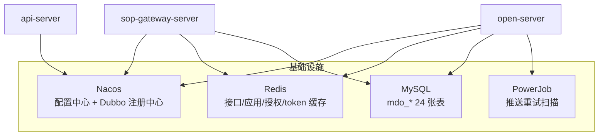
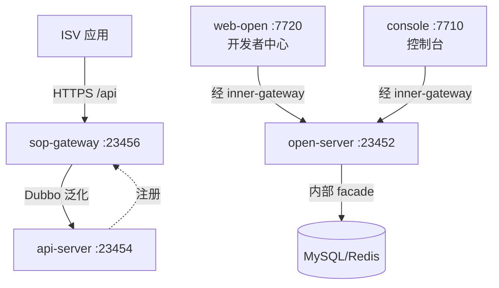

本篇从业务、技术、部署三个视角拆解开放平台的架构，回答一个问题：**开放平台各服务各自管什么、有什么联系**。

## 1. 业务架构

开放平台上有三类角色，各自使用不同的前端入口：

| 角色 | 入口 | 干的事 |
| ---- | ---- | ---- |
| 平台方/二开工程师 | 源码 | 新增 `@Open` 接口、维护 SDK、扩展网关 |
| 运营 | web-console 控制台 | 审核应用申请、维护权限分组并授权、管理接口上下架、维护 OAuth2 scope、查看调用日志与推送日志 |
| 开发者（ISV） | web-open 开发者中心 | 提交应用申请、管理密钥与回调配置、订阅事件、查看接口文档并在线调试 |

三条核心业务流：

**① 应用入驻流**（详见[应用审核与授权](应用审核与授权.md)）

**② 接口上架流**（详见[接口开发与发布](接口开发与发布.md)）

**③ 运行时调用流**（详见[调用链路与扩展点](调用链路与扩展点.md)）

## 2. 技术架构

### 2.1 组件清单

| 组件 | 模块 | 端口 | 关键技术 | 职责 |
| ---- | ---- | :--: | ---- | ---- |
| 开放网关 | `sop-gateway-server` | 23456 | Spring MVC、Dubbo 泛化调用、Redis | 参数解析、10 项校验、RSA2 验签、路由、结果包装、调用日志 |
| 接口实现 | `md-api`（api-server） | 23454 | Dubbo Provider、smart-doc | `@Open` 业务接口实现，启动自动注册到网关 |
| 管理后台 | `md-open`（open-server） | 23452 | MyBatis-Flex、PowerJob 客户端、Hutool HTTP | 应用/密钥/分组/文档/事件/OAuth2 数据管理，推送管道 |
| Java SDK | `mdp-sdk` | — | okhttp、fastjson2、RSA2/AES | 第三方调网关、接收推送的加解密工具 |
| 文档系统 | Torna（外部部署） | 自定 | Torna open API | 接口文档托管，开放平台经 `doc.list`/`doc.details` 同步 |

> 端口为本地开发默认值，来源见[服务介绍](../../start/服务介绍.md)。

### 2.2 运行时依赖

- **Dubbo 注册中心**是网关与接口实现之间的唯一纽带：api-server 把 `@DubboService` 暴露到注册中心，网关用**泛化调用**（`GenericServiceInvoker`，`generic=true`）按接口名动态发起调用，不依赖 api-pojo 的类；
- **接口注册**同样走 Dubbo：网关把 `ApiRegisterService` 暴露为 Dubbo 服务（`ApiRegisterServiceImpl.java:24-25`），api-server 启动时经 `@DubboReference` 远程调用它上报接口清单；
- **Redis** 承载运行时热数据：接口元信息（`{apiName}:{version}`→id）、应用密钥与 RSA 公钥、应用可访问接口列表、accessToken 映射（详见各篇）。

### 2.3 数据流分类

| 数据流 | 通道 | 方向 |
| ---- | ---- | ---- |
| 第三方业务调用 | HTTP `/api` → Dubbo 泛化 | ISV → 网关 → api-server |
| 接口注册 | Dubbo `ApiRegisterService` | api-server → 网关 |
| 文档产出 | smart-doc HTTP 推送 | api-server → Torna |
| 文档同步 | Torna open API 拉取 | open-server ← Torna |
| 事件/回调推送 | HTTP POST（AES 三模式） | open-server → ISV |
| 管理操作 | HTTP（经 inner-gateway 或单体直连） | web-open/console → open-server |

## 3. 部署形态

开放平台四件套在两种部署形态下的落点不同：

| 组件 | 单体版（boot） | 微服务版（cloud） |
| ---- | ---- | ---- |
| 管理后台 open-web | 并入 **boot-server**（23455） | 独立 **open-server**（23452） |
| 接口实现 api-service | 由 **worker-server**（23457）兼任（pom 依赖 api-web + sop-spring-boot-starter） | 独立 **api-server**（23454） |
| 开放网关 | **sop-gateway-server**（23456）两种形态都独立部署 | 同左 |
| Torna | 独立部署，两种形态相同 | 同左 |

::: tip 为什么接口实现放在 worker-server

单体版把「定时任务执行器」与「开放接口实现」合在一个进程：`@DubboService` 的暴露与注册对部署形态透明，sop-gateway 只认注册中心里的服务，不关心 provider 是谁。二开新增接口时无需关心这一差异——代码都写在 md-api 模块，由构建配置决定由谁加载。

:::

微服务版完整链路（含前端入口）：

## 4. 核心机制速查

| 机制 | 一句话 | 详解 |
| ---- | ---- | ---- |
| 接口注册 | api-server 启动时扫描 `@DubboService` Bean，收集 `@Open` 方法经 Dubbo 上报网关，落 `mdo_api` 并预热 Redis | [接口开发与发布](接口开发与发布.md) |
| 请求校验 | 网关固定顺序 10 项校验（接口存在/字段/应用/授权/签名/超时/格式/IP 黑名单/上传/token） | [调用链路与扩展点](调用链路与扩展点.md) |
| 签名验签 | 公共参数字典序拼接，RSA2（SHA256WithRSA），公钥取自 `mdo_app_keys.public_key_app` | [调用链路与扩展点](调用链路与扩展点.md) |
| accessToken | `accessToken.get`（强制签名）颁发，双 SHA-256 生成，Redis 双 key，固定 2 小时 | [接口调用](接口调用.md) |
| 接口授权 | 应用 → 权限分组 → 接口 三表链，网关 `hasPermission` 判定，缓存 `AppApiCkBuilder` | [应用审核与授权](应用审核与授权.md) |
| 应用审核 | AppApply 状态机 0/1/2/99，通过即生成 appKey/appSecret + AppKeys | [应用审核与授权](应用审核与授权.md) |
| 文档链路 | smart-doc 推 Torna，开放平台手动同步拉回，发布后开发者可见 | [接口开发与发布](接口开发与发布.md) |
| 事件/回调推送 | 统一管道 NotifySender，AES 三模式，5 档重试（2m/5m/30m/6h/12h） | [事件回调](事件回调.md) |
| 调用日志 | 网关拦截器建日志，Spring 事件异步落 `mdo_api_call_log` | [调用链路与扩展点](调用链路与扩展点.md) |
