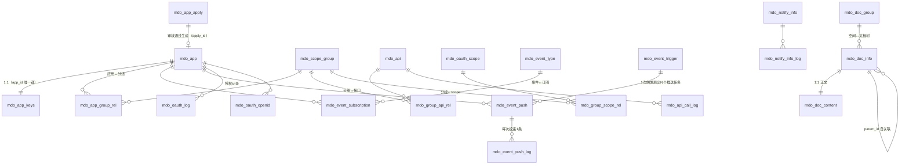

开放平台的数据全部落在 **24 张 `mdo_` 前缀表**中，实体位于 `md-open/open-pojo` 的 `top.mddata.open.entity.admin` 包（`Xxx` 继承 `XxxBase`，与全平台一致的 Base+DO 双层结构，见 [md-common-pojo](../../source/md-public/md-common-pojo.md)）。DDL 统一维护在 mdp 仓库的 `docs/mdp.sql`。

## 1. 五域分组总览

| 域 | 表 | 作用 |
| ---- | ---- | ---- |
| 应用域 | `mdo_app`、`mdo_app_keys`、`mdo_app_apply` | 应用、密钥与回调配置、入驻申请单 |
| 接口与授权域 | `mdo_api`、`mdo_scope_group`、`mdo_app_group_rel`、`mdo_group_api_rel`、`mdo_group_scope_rel`、`mdo_oauth_scope`、`mdo_api_call_log` | 接口注册表、权限分组三表授权链、OAuth2 scope、调用日志 |
| 文档域 | `mdo_doc_group`、`mdo_doc_info`、`mdo_doc_content`、`mdo_help_doc` | 文档空间、文档树、文档正文、帮助文档 |
| 事件与回调域 | `mdo_event_type`、`mdo_event_subscription`、`mdo_event_trigger`、`mdo_event_push`、`mdo_event_push_log`、`mdo_notify_info`、`mdo_notify_info_log` | 事件类型、订阅、触发记录、推送任务与日志、接口回调任务与日志 |
| OAuth2 域 | `mdo_oauth_log`、`mdo_oauth_openid`、`mdo_oauth_unionid` | 授权记录、openid、unionid |

## 2. ER 图



## 3. 应用域

### mdo_app（应用）

| 字段 | 说明 |
| ---- | ---- |
| `app_key` / `app_secret` | 应用 Key / 密钥。审核通过时生成：appKey = `yyyyMMdd` + 随机 10 位，appSecret = 随机 36 位（`AppApplyServiceImpl.java:123,128`） |
| `login_type` | 登录方式：`10`-ticket，`20`-OAuth2 |
| `type` | 应用类型：`10`-自建，`20`-第三方 |
| `state` / `show` / `is_public` | 启用状态 / 是否出现在"我的应用" / 是否公开应用 |
| `allow_ip` | IP 白名单 |
| `sso_push` / `sso_push_url` | 单点登录消息推送开关与地址 |
| `oauth2_allow_redirect_uris` / `oauth2_allow_grant_types` | OAuth2 允许的回调地址与授权类型 |
| `oauth2_*_token_timeout` | OAuth2 各 token 超时（秒），**-1 = 读全局配置** `ConfigKey.Open.APP_*` |
| `oauth2_new_refresh` / `oauth2_is_confirm` | refreshToken 刷新策略 / 是否自动授权（跳过确认页） |
| `apply_id` | 来源申请单 ID（关联 `mdo_app_apply`） |
| `validity_start` / `validity_end` | 应用级有效期（网关 `checkApp` 校验，`ApiValidator.java:258-278`） |

### mdo_app_keys（密钥与推送配置，app_id 唯一键）

| 字段 | 说明 |
| ---- | ---- |
| `public_key_app` | **开发者 RSA2 公钥**。开发者自生成密钥对后上传，平台用它验签请求；私钥开发者自持 |
| `notify_url` / `notify_state` | 事件推送地址 / 通知开关 |
| `notify_encryption_type` | 推送加密模式：`0`-明文，`1`-兼容，`2`-安全 |
| `notify_token` / `notify_encoding_aes_key` | 推送签名校验令牌 / AES 密钥（43 字符） |

### mdo_app_apply（应用申请单）

| 字段 | 说明 |
| ---- | ---- |
| `name` / `intro` / `home_url` / `logo` / `credential_file` | 申请资料（名称/简介/主页/图标/资质文件） |
| `audit_status` | 审核状态：`0`-待提交，`1`-待审批，`2`-通过，`99`-退回（`AuditStatusEnum`） |
| `submission_at` / `audit_at` / `review_comments` | 提交时间 / 审核时间 / 审核意见 |

## 4. 接口与授权域

### mdo_api（开放接口注册表）

| 字段 | 说明 |
| ---- | ---- |
| `app_name` | 提供接口的服务名（`spring.application.name`），**全局唯一约束** |
| `api_name` / `api_version` | 接口名（`@Open` 的 value，如 `user.page`）/ 版本（默认 `1.0`） |
| `interface_class_name` / `method_name` | Dubbo 接口类全名 / 方法名（网关泛化调用的目标） |
| `param_info` | 参数信息 JSON（注册时反射生成） |
| `permission` | 是否需要授权：`0`-否（直接放行），`1`-是（走三表授权链判定） |
| `need_token` / `need_sign` | 是否需要 accessToken / 是否验签（RSA2） |
| `reg_source` | 注册来源：`1`-系统注册（启动自动上报），`2`-手动注册 |
| `api_mode` | 接口模式：`1`-open 接口，`2`-Restful（`@OpenGroup` 标记，当前未使用） |
| `state` | `1`-启用，`0`-禁用（网关 `checkApiInfo` 校验） |

### 授权链三表 + scope

`mdo_scope_group`（权限分组：`name`/`weight`/`state`）是授权的中心枢纽：

```
mdo_app ──mdo_app_group_rel──> mdo_scope_group ──mdo_group_api_rel──> mdo_api
                                              └─mdo_group_scope_rel──> mdo_oauth_scope
```

- `mdo_app_group_rel`：`app_id` + `group_id`（应用被授予哪些分组）
- `mdo_group_api_rel`：`group_id` + `api_id`（分组包含哪些接口）
- `mdo_group_scope_rel`：`group_id` + `scope_id`（分组包含哪些 OAuth2 scope）
- `mdo_oauth_scope`：OAuth2 权限定义，`code`/`name`/`apply_prompt`（申请提示语）/`confirm_prompt`（确认提示语）/`level`（`1`-公开，`2`-特殊，特殊权限必须填申请提示语）

网关判定逻辑见[应用审核与授权 · 接口权限授权](应用审核与授权.md)。

### mdo_api_call_log（调用日志）

网关每次调用落一条：`trace_id`、`app_id`/`app_key`、`request_ip`、`api_id`/`api_name`/`api_version`、`param_info`、`request_header`、`exec_status`（`1`-成功，`2`-失败）、`response_data`、`error_msg`。

## 5. 文档域

| 表 | 重点字段 | 说明 |
| ---- | ---- | ---- |
| `mdo_doc_group` | `name`、`token`、`publish` | 文档空间（对应一个 Torna 空间，`token` 为 Torna open token） |
| `mdo_doc_info` | `doc_group_id`、`doc_title`、`doc_type`、`source_type`、`doc_name`、`doc_version`、`folder`、`publish`、`parent_id`、`weight` | 文档树节点。`doc_type`：`1`-dubbo `2`-富文本 `3`-Markdown；`source_type`：`1`-Torna `2`-自建；`publish`：`0`-未发布 `1`-已发布 |
| `mdo_doc_content` | `doc_info_id`、`content` | 文档正文 JSON（与 doc_info 1:1） |
| `mdo_help_doc` | `title`、`content`、`tree_path`、`content_type`、`parent_id`、`state`、`weight` | 帮助文档树（运营手工维护） |

## 6. 事件与回调域

**事件推送链**（主数据变更 → 订阅应用）：

| 表 | 重点字段 | 说明 |
| ---- | ---- | ---- |
| `mdo_event_type` | `code`（唯一）、`name`、`state`、`weight` | 事件类型，如 `org:add`、`user:edit`（见 `EventTypeCode` 常量） |
| `mdo_event_subscription` | `app_id`、`event_type_id` | 应用订阅关系 |
| `mdo_event_trigger` | `event_code`、`event_id`、`trigger_at`、`event_content` | 一次事件触发记录（业务侧组 `EventTriggerDto` 写入） |
| `mdo_event_push` | `event_trigger_id`、`app_id`/`app_key`、`notify_url`、加密配置快照、`next_request_time`、`max_request_cnt`、`request_cnt`、`exec_status` | 推送任务：一次触发按订阅**扇出**为 N 个任务 |
| `mdo_event_push_log` | `event_push_id`、`request_data`、`response_data`、`exec_status`、`error_msg` | 每次投递一条日志 |

**接口回调链**（耗时接口异步通知）：

| 表 | 说明 |
| ---- | ---- |
| `mdo_notify_info` | 回调任务，结构与 event_push 同构，多 `call_log_id`/`api_name`/`api_version` |
| `mdo_notify_info_log` | 回调投递日志 |

推送任务状态机 `exec_status`（`ExecStatusEnum`）：`0`-待执行，`1`-成功，`2`-失败，`3`-重试结束，`4`-手动结束。

::: tip 设计要点：配置快照冗余

`mdo_event_push` / `mdo_notify_info` 建任务时把 `notify_url`、`notify_encryption_type`、`notify_token`、`notify_encoding_aes_key` 从 `mdo_app_keys` **冗余快照**到任务行（`EventPushServiceImpl.java:91-94`）。之后开发者修改回调配置不影响已生成的任务，重试仍按快照投递。

:::

## 7. OAuth2 域

| 表 | 重点字段 | 说明 |
| ---- | ---- | ---- |
| `mdo_oauth_log` | `app_id`、`user_id`、`openid`、`unionid`、`access_token`/`access_token_expires`、`refresh_token`/`refresh_token_expires`、`grant_type`、`scopes`、`token_type`、`redirect_uri` | 每次授权/换 token 的记录 |
| `mdo_oauth_openid` | `app_id`、`user_id`、`openid` | openid（应用维度隔离的用户标识） |
| `mdo_oauth_unionid` | `subject_id`、`user_id`、`unionid` | unionid（同一主体下跨应用联合标识） |

OAuth2 登录链路的机制说明见[单点登录-oauth2模式](../../integration/单点登录/oauth2模式.md)，本篇只列数据落点。

## 8. 二开注意事项

::: warning 新增表请遵循既有规范

- 表名统一 `mdo_` 前缀（开放平台域），实体按 Base+DO 双层拆解，存放在 `open-pojo`；
- 状态类字段复用已有枚举（`AuditStatusEnum`、`ExecStatusEnum`、`StateEnum`），不要新造一套取值。

:::
