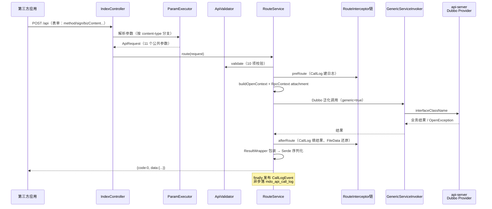

本篇拆解一次第三方请求在 sop-gateway 内的完整旅程，并列出每个环节的扩展点——二开时**在哪里插入自己的逻辑**。

## 1. 全链路总览



## 2. 入口与参数解析

**入口**（`IndexController.java:69-99`）：

| 入口 | 路径 | 用途 |
| ---- | ---- | ---- |
| 标准入口 | `${mdp.gateway.path:/api}` | 表单协议（method/version/sign/bizContent），绝大多数接口 |
| REST 入口 | `${mdp.gateway.rest}/**` | Restful 风格（URI 截取 apiName、`?v=` 指定版本），走简化校验 `validateRest` |

**参数解析**（`ParamExecutorImpl.build`，`ParamExecutorImpl.java:54-118`）：按 content-type 分支（JSON/text、multipart、form、GET）解析出 11 个公共参数。参数名可被 `mdp.api.*` 配置覆盖（`GateApiConfig.java:12-13` 继承 `ApiConfig`），默认值：

| 参数 | 必填 | 说明 |
| ---- | ---- | ---- |
| `appKey` | 是 | 应用 Key |
| `method` | 是 | 接口名（`@Open` 的 value） |
| `version` | 否 | 接口版本，默认 `1.0` |
| `format` | 否 | 返回格式，默认 `json` |
| `charset` | 是 | 编码，固定 `UTF-8` |
| `signType` / `sign` | 视接口 | 签名算法（RSA2/RSA）与签名串，`needSign=1` 时必填 |
| `timestamp` | 是 | `yyyy-MM-dd HH:mm:ss`，超时校验用 |
| `accessToken` | 视接口 | 访问令牌，`needToken=1` 时必填 |
| `notifyUrl` | 否 | 异步回调地址 |
| `bizContent` | 是 | 业务参数 JSON |

## 3. 校验：ApiValidator 的 10 项检查

`ApiValidator.validate`（`ApiValidator.java:79-103`）按固定顺序执行，任何一项不过即中断：

| # | 检查 | 内容 | 代码 |
| ---- | ---- | ---- | ---- |
| 1 | checkApiInfo | 接口存在且启用（先查 Redis，未命中查 `mdo_api`） | :127-136 |
| 2 | checkField | `needSign=1` 时要求 signType/sign 非空 | :149-179 |
| 3 | checkApp | appKey 存在、应用启用、在有效期（`validity_start/end`） | :258-278 |
| 4 | checkPermission | 接口授权判定（见[接口开发与发布 §4](接口开发与发布.md)） | :138-147 |
| 5 | checkSign | RSA2 验签（公钥取自 `mdo_app_keys.public_key_app`，Redis 缓存） | :280-302 |
| 6 | checkTimeout | timestamp 与服务器时差 ≤ `timeoutSeconds`（默认 300 秒） | :236-256 |
| 7 | checkFormat | format 合法性 | :305-315 |
| 8 | checkIP | IP 黑名单（`IpBlacklistManager`） | :187-191 |
| 9 | checkUploadFile | 上传文件大小/类型 | :199-221 |
| 10 | checkToken | accessToken 非空（有效性留给拦截器） | :326-336 |

::: tip REST 入口是简化版

`validateRest`（:106-125）不验签名、不验超时、不验授权，仅供平台内部或低风险场景使用。二开新增 Restful 接口前先评估是否接受这个安全水位。

:::

## 4. 路由与拦截器链

`RouteServiceImpl.route`（`RouteServiceImpl.java:64-136`）是总编排：

```
validate → doPreRoute（拦截器 preRoute）→ doRoute（泛化调用）
        → doAfterRoute（拦截器 afterRoute）→ ResultWrapper.wrap
异常 → ExceptionExecutor 转标准错误；finally → CallLogEvent 异步落库
```

**内置拦截器**（实现 `RouteInterceptor`，按 `getOrder` 排序，`RouteInterceptorOrders.java:10-11`）：

| 拦截器 | order | 职责 |
| ---- | ---- | ---- |
| `CallLogRouteInterceptor` | -20000（最前） | 建/填 `ApiCallLog`（traceId、请求头、响应、耗时） |
| `ResultRouteInterceptor` | -1000 | FileData 下载结果还原 |
| `TokenValidateInterceptor` | 0（默认） | `needToken=1` 时查 Redis `{appKey}:{token}`→appId，复合 key 防跨应用冒用（`TokenValidateInterceptor.java:28-67`） |

**泛化调用**（`GenericServiceInvoker.java:48-57`）：按 `mdo_api` 的 `interfaceClassName + methodName + paramInfo` 组装 Dubbo 泛化参数，`generic=true`，`ReferenceConfig` 有缓存，超时 `${generic.timeout:5000}`。调用前把 `OpenContext`/`WebContext` 塞进 `RpcContext` attachment（`RouteServiceImpl.java:150-153`）。

## 5. Provider 端（api-server）

- **上下文恢复**：`SopDubboProviderFilter`（Dubbo SPI 注册）从 attachment 取出上下文并 `initContext`，业务代码里用 `OpenContext.current()` 或直接声明 `OpenContext` 方法参数（`RouteServiceImpl.buildInvokeParam :203-206`）获取调用方 appKey、notifyUrl 等；
- **异常翻译**：`GlobalExceptionFilter`（`api-service/.../message/GlobalExceptionFilter.java:19-36`，注册于 `META-INF/dubbo/org.apache.dubbo.rpc.Filter`）把 `ArgumentException` 包装成 `OpenException`；
- **错误解析**：网关 `ExceptionExecutorImpl`（:39-82）按 `<OPEN_ERROR>code@@msg@@solution` 格式拆成标准错误响应（`subCode/subMsg/solution`）。

## 6. 签名与 accessToken 细节

**验签**（`PlatformSigner` + `SignUtil`）：

1. 取全部公共参数（`SkipNullHashMap` 自动跳过 null），剔除 `sign`；
2. 按 key 字典序拼 `key=value&...`（`SignUtil.getSignCheckContentV2 :242-262`，`bizContent` 作为整串参与）；
3. RSA2 = SHA256WithRSA 验签（:340-360），公钥来自 `AppManagerImpl.getPublicKeyApp`（Redis 缓存 + `mdo_app_keys.public_key_app`）。

> 应用级 `appSecret` 当前只用于 `accessToken.get` 的凭证校验，**不参与验签**——验签用的是开发者 RSA 密钥对。

**accessToken**：

| 环节 | 实现 |
| ---- | ---- |
| 颁发 | `accessToken.get`（`needToken=false, needSign=true`，`TokenOpenService.java:22-23`）→ appKey+appSecret 校验 → 双 SHA-256 生成 128 位 hex（`TokenOpenServiceImpl.java:112-116`） |
| 存储 | Redis 双 key：`{appKey}:{token}`→appId、`{appKey}`→token，固定 2 小时（`AccessTokenCkBuilder.DEFAULT_EXPIRE`） |
| 复用 | 非 `forceRefresh` 且旧 token 未过期直接返回旧值（:65-79） |
| 校验 | `TokenValidateInterceptor` 用复合 key 反查 appId |

## 7. 扩展点清单

### 7.1 首选：自定义 RouteInterceptor

网关的拦截器机制是**真正的扩展点**：实现 `RouteInterceptor` 接口并声明为 `@Component`，自动加入链路（`RouteInterceptor.java:12-64`，`init/preRoute/afterRoute/getOrder/match` 均有 default 实现，按需覆写）。

```java
@Component
public class GrayRouteInterceptor implements RouteInterceptor {
    @Override
    public void preRoute(ApiRequestContext ctx) {
        // 例：按 appKey 灰度、自定义限流、追加审计字段
    }

    @Override
    public int getOrder() {
        return 100; // 在内置拦截器（-20000/-1000/0）之后执行
    }

    @Override
    public boolean match(ApiRequestContext ctx) {
        return true; // 可按 apiName/appKey 过滤生效范围
    }
}
```

### 7.2 Bean 替换（谨慎）

网关内下列组件是「接口 + 单一实现」模式，可注册同类型自有 Bean 替换：

| 接口 | 默认实现 | 替换场景 |
| ---- | ---- | ---- |
| `SopValidator` | `ApiValidator` | 增删校验项、调整校验顺序 |
| `Signer` | `PlatformSigner` | 支持 SM2 等国密算法（`ApiValidator` 按 by-name 注入，注意 Bean 名） |
| `RouteService` | `RouteServiceImpl` / `RestRouteServiceImpl` | 整体改造路由（`IndexController` 用 `@Qualifier("routeService")` 注入） |
| `ParamExecutor` | `ParamExecutorImpl` | 自定义参数协议 |
| `Serde` | `SerdeImpl` | 自定义序列化（Long→字符串、日期格式 `${mdp.gateway.serialize.date-format}`） |
| `ResultWrapper` | `ResultWrapperImpl` | 改响应壳结构 |
| `ExceptionExecutor` | `ExceptionExecutorImpl` | 改错误响应格式 |
| `AppManager` / `ApiManager` / `IpBlacklistManager` | 各 Impl | 换数据源（如应用信息走外部 IAM） |

::: warning 没有 @ConditionalOnMissingBean

网关组件**没有**声明 `@ConditionalOnMissingBean`，注册同类型 Bean 会产生冲突。替换方式：用 `@Primary` 标注自有实现，或直接排除默认实现所在的自动装配/组件扫描。改动前通读默认实现，确保行为等价。

:::

### 7.3 框架层扩展点（md-sop-support）

| 扩展点 | 方式 |
| ---- | ---- |
| Dubbo 过滤器 | `META-INF/dubbo/org.apache.dubbo.rpc.Filter` 注册（参照 `GlobalExceptionFilter`、`SopDubboProviderFilter`） |
| `WebContext` / `OpenContext` | 接口可替换 Default 实现 |
| `OpenMessage` / `OpenMessageFactory` | 响应消息与国际化 |
| `RegisterCallback` | 接口注册完成后的钩子 |
| 文档模板 | smart-doc `IDocBuildTemplate` SPI（参照 `SopDocBuildTemplate`） |

详见 [md-sop-support](../../source/mdp-base/md-sop-support.md)。

## 8. 常见二开场景指引

| 想做什么 | 推荐落点 |
| ---- | ---- |
| 加限流/灰度/审计 | 自定义 `RouteInterceptor`（7.1），不要改 `ApiValidator` |
| 加一种签名算法 | 替换 `Signer` Bean + SDK 侧 `SignUtil` 同步实现 |
| 调用日志额外写 ES/Kafka | 监听 `CallLogEvent`（参照 `CallLogListener.java:25-34` 的 `@Async("apiCallLogExecutor")`） |
| 自定义错误码体系 | `OpenMessage` 体系 + `ExceptionExecutor` |
| 接口级监控埋点 | `CallLogRouteInterceptor` 的 afterRoute 已有时长/状态，监听事件扩展即可 |
