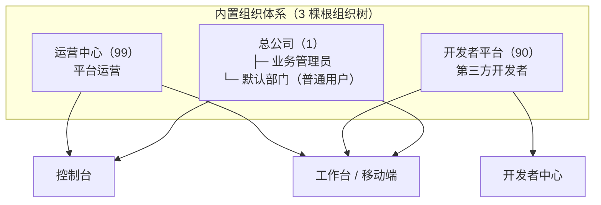

本项目核心定位为企业级**主数据平台**，全称「主数据平台」，简称「MDP」「MDDATA」。平台内置 3 个核心应用（工作台、控制台、开发者中心），提供标准化的基础开发与集成能力，基于本平台可快速搭建新业务应用，也可无缝集成企业已有应用，实现全域数据统一、权限统一、接口统一。

### 项目名称

| 名称类型 | 名称 |
| -------- | ---- |
| 中文全称 | 主数据平台 |
| 英文全称 | master-data-platform |
| 简称 | MDP |
| 简称 | mddata |
| 品牌域名 | mddata.top |

> MDP 与 mddata 两个简称通用，不作强制区分：一般在指代平台本身时使用 MDP，在指代品牌、域名（如 workbench.mddata.top）时使用 mddata。

平台内置应用也有对应的固定简称，命名规则为「md + 应用名首字母」：

| 应用 | 后端工程 | 前端工程 | 简称 |
| ---- | -------- | -------- | ---- |
| 工作台 | md-workbench | web-workbench | mdw |
| 控制台 | md-console | web-console | mdc |
| 开发者中心 | md-open | web-open | mdo |

### 3大核心应用

| 应用名称     | 其他名称 | 什么人适合使用本应用 | 备注                     |
| ------------ | --------- | ------------ | ------------------------- |
| 工作台       | 用户中心、用户门户 | 所有用户   | mdp内置应用，承载用户登录、应用跳转、个人中心等基础能力 |
| 控制台       | 管理后台、管理中台、基础平台 | 系统管理员   | mdp内置应用，平台基础数据、应用管理等能力 |
| 开发者中心   | 开放平台 | 第三方开发者 | mdp内置应用，第三方应用接入、接口、文档查看 |
| 其他应用 | 子系统、第三方应用 | 所有用户 | **非内置**，分两类：①企业基于 MDP 自主开发的业务子系统；②第三方公司的应用经单点登录/开放接口对接到平台。两类在平台上的注册、授权、管控方式完全相同 |

- 工作台（又名：**用户中心**）

  定位为**普通用户专属门户**，是普通用户登录系统，跳转到其他应用的统一入口，核心功能是单点登录、单点注销、个人账号管理、应用访问、消息中心、个人日志。

  - 统一注册与登录：支持登录、注册、找回密码，同时兼容第三方账号关联与登录，实现多渠道便捷接入。
  - 个人中心：个人信息修改、头像上传与更换。
  - 安全设置：账号密码修改、手机号修改、多因素登录验证、邮箱修改。
  - 登录日志：支持查询个人账号所有登录记录（含登录时间、登录 IP、登录设备），便于异常登录排查。
  - 我的应用：可查询平台内所有可访问应用，支持应用免密快捷登录、常用应用收藏，提升访问效率。
  - 消息中心：聚合展示平台及所有子应用的消息通知，支持消息查看、标记已读，实现消息统一管理。

- 控制台（又名：**管理后台**）

  定位为**系统管理员专属操作后台**，核心功能是平台全局管控、数据维护、权限分配与应用管理，支撑平台规范化运维。

  - 主数据维护：统一维护平台核心基础数据，包括组织架构、岗位、人员信息、数据字典、应用菜单等，保障全域数据一致性。
  - 权限管理：用户访问系统权限、应用获取数据的接口权限、应用数据接口监控与限流。
  - 应用管理：应用查询、应用创建、应用审核、应用发布、接口管理、文档管理。
  - 系统配置：全局参数配置、短信模版、邮件模版、OSS存储配置。
  - 日志管理：操作日志、登录日志、对象上传日志。
  - 数据大屏：常用数据统计页面

- 开发者中心（又名：**开放平台**）

  定位为**第三方开发者专属接入平台**，核心功能是支撑外部应用快速接入本平台，实现数据互通、单点登录对接，降低集成成本。

  - 应用管理：申请应用、管理应用、设置应用的秘钥、应用权限申请、查看平台提供的接口文档。
  - 数据订阅（推数据）：支持应用订阅平台主数据，当主数据发生新增、修改、删除等变更时，平台会自动推送事件通知至订阅应用，保障数据实时同步。
  - 接口调用（拉数据）：开发者可通过 SDK 或 HTTP 接口两种方式，调用平台开放的接口，主动获取所需主数据，适配不同集成场景。
  - 文档查看：提供平台所有开放接口的标准化文档，包含接口参数、返回示例、调用说明，便于开发者快速对接调试。
  - 接口授权与管控：对开放接口的调用进行授权、鉴权与流量限流，保障接口调用安全，防止恶意请求影响平台稳定性。

- 其他应用（又名：子系统、第三方应用） **（需自主开发或自行对接）**

  除上述 3 个内置核心应用外，开发者可基于 MDP 主数据平台的基础框架，**自行开发新的业务应用**（如企业内部业务系统、个性化管理工具等）；也可将企业已有的历史应用或第三方公司的应用，通过平台提供的单点登录、接口对接能力，**无缝集成至本平台**，实现全域应用统一管控、数据互通共享。两类应用接入平台的方式完全相同：在平台注册应用、配置密钥与登录方式、按需申请接口权限。

## 角色与组织体系

平台的权限体系建立在「**组织性质**」之上：组织决定用户属于哪套身份体系，角色决定用户在该体系内拥有什么权限。每个账号都有一个归属组织（含组织性质），账号的具体权限通过绑定角色获得。

### 内置组织

平台初始化时内置了 **3 个根组织 + 1 个默认部门**，分别对应三种组织性质（`OrgNatureEnum`），三棵组织树物理隔离：

| 内置组织 | 组织性质 | 说明 |
| -------- | -------- | ---- |
| 运营中心 | `99`-运营 | 平台方运维/运营人员的组织根，运维管理员（ops_admin）挂在这棵树下 |
| 开发者平台 | `90`-开发者 | 第三方开发者的组织根，开发者管理员（open_admin）与审核通过的开发者挂在这棵树下 |
| 总公司 | `1`-总公司 | 企业用户的组织根，业务管理员（admin）挂在根上，企业自建的部门都挂在这棵树下 |
| 默认部门 | （挂在总公司下） | **普通用户注册的默认落点**：未指定部门的注册用户自动落入「总公司 → 默认部门」 |

> 组织性质是贯穿全平台的设计主线：角色、权限、菜单、统计全部按性质隔离（运营看全平台数据，其他性质只看自己的组织子树）。机制详解见[用户和组织体系](../advanced/用户和组织体系.md)。

### 内置角色

平台所有角色都归属于三种**角色分类**（`RoleCategoryEnum`）之一，分类决定这个角色"能干什么"：

| 角色分类 | 含义 | 能否绑定用户 | 数量约束 |
| -------- | ---- | ------------ | -------- |
| `10` 普通角色 | **日常授权的最小单元**：管理员在「角色管理」中创建的业务角色（如"人事专员"），可分配的权限范围受同性质权限集合约束 | ✅ | 不限 |
| `20` 管理员角色 | **该组织性质下的最高权限角色**，以模板形式预置，权限由运营统一配置，绑给该性质的管理员账号 | ✅ | 每个组织性质最多 1 个 |
| `30` 权限集合 | **划定该性质下普通角色可授权范围的上限**：普通角色授权时，可选的应用/菜单/数据/字段全部取自同性质权限集合已授权的内容 | ❌（不参与授权绑定） | 每个组织性质最多 1 个 |

通俗理解：**权限集合**决定"能授出什么"，**管理员角色**是该性质的"最高权限账号身份"，**普通角色**是被圈定范围内的日常授权载体。

平台初始化时按三种组织性质各预置一组，共 **9 个内置角色（3 权限集合 + 3 管理员角色 + 3 普通角色）**：

| 角色分类 | 运营体系（99） | 开发者体系（90） | 总公司体系（1） |
| -------- | -------------- | ---------------- | -------------- |
| 权限集合 | 运营管理员权限集 `OPERATIONS_ADMIN_COLL` | 开发者管理员权限集 `DEVELOPER_ADMIN_COLL` | 总公司管理员权限集 `ADMIN_COLL` |
| 管理员角色 | 运维管理员 `OPERATIONS_ADMIN`（演示账号 ops_admin） | 开发者管理员 `DEVELOPER_ADMIN`（open_admin） | 业务管理员 `ADMIN`（admin） |
| 普通角色 | 运营普通管理员 `OPERATIONS_SIMPLE_ADMIN` | 开发者 `DEFAULT_DEVELOPER`（注册+审核后自动绑定） | 普通用户 `DEFAULT_USER`（注册即绑定） |

> 前 8 个编码收录在 `RoleCode.BUILT_IN_CODES` 保留编码中（普通角色禁止使用）；`OPERATIONS_SIMPLE_ADMIN` 仅在初始化 SQL 中预置，作为运营体系下普通角色的示例。

各管理员角色的职责：

- **运维管理员（又名：平台管理员）**

  定位为**平台方运维/运营人员专属角色**，是平台内置的超级管理员，拥有一切权限。核心职责：

  - 配置平台所有基础数据：菜单、字典、参数、附件、代码生成器等。
  - 管理角色模板、权限集，决定各类管理员角色能拥有和能分配的最大权限范围。
  - 为其他管理员（业务管理员、开发者管理员）分配权限。

- **开发者管理员（又名：开放平台管理员）**

  定位为**开放平台的审核与管理者**，核心职责：

  - 审核开发者入驻申请：开发者注册后需经审核通过方可登录开发者中心。
  - 管理开放平台的应用准入、接口开放范围、接口授权与限流策略。

- **业务管理员（又名：管理员）**

  定位为**企业内部管理员**，核心职责：

  - 维护本企业的组织架构、岗位、用户、角色。
  - 为本企业普通用户分配权限、开通账号。
  - 可新建自建角色，但可分配的权限不能超过自身拥有的权限（受同组织性质下「权限集」约束）。

普通角色中：**开发者**相比普通用户多出开发者中心的访问能力（应用申请、接口调用、数据订阅、文档查看）；**普通用户**仅拥有工作台的基础权限（登录、个人中心、我的应用、消息中心等），访问子应用等其他权限需管理员在后台配置。

### 自建角色

除内置角色外，业务管理员可在控制台「角色管理」中按业务需要创建自定义角色（普通角色）并分配用户。自建角色可分配的权限来源于当前组织性质下的权限集，不能超出权限集范围。

### 角色相关概念

- **角色模板**：管理员角色与权限集合以模板形式预置，权限由运维管理员在「角色模板管理」中统一配置，内置管理员角色的权限不可自行修改。
- 三分类的完整机制（授权面板、缓存、删除级联）见[角色管理](../advanced/角色管理.md)。

## 使用平台的用户群

从产品视角看，MDP 的使用者分为三类人群，各自落在不同的组织体系、使用不同的应用入口：

| 用户群 | 组织体系（性质） | 使用的应用 | 典型角色/账号 | 他们关心的事 |
| ------ | ---------------- | ---------- | ------------- | ------------ |
| **平台运营** | 运营中心（99） | 控制台、工作台 | 运维管理员（ops_admin）、开发者管理员（open_admin） | 平台全局配置、权限模板、开发者入驻审核、应用与接口的准入/授权、数据大屏 |
| **第三方开发者** | 开发者平台（90） | 开发者中心、工作台 | 开发者（注册+审核产生） | 申请应用、获取 appKey/密钥、订阅事件、调开放接口、查接口文档——接入指南见[应用接入](../integration/README.md) |
| **企业管理员 / 普通用户** | 总公司（1） | 控制台（管理员）、工作台/移动端（普通用户） | 业务管理员（admin）、普通用户（注册产生） | 管理员：维护本企业组织/用户/角色/权限；普通用户：单点登录、使用被授权的业务应用、个人中心与消息 |

