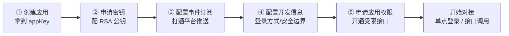

接入 MDP 平台前，您需要在[开发者中心](https://open.mddata.top/)完成五步准备工作。**顺序有讲究**：密钥不配置好，连 accessToken 都换不到；事件订阅不配置，收不到任何推送；权限不申请，受限接口一律拒绝。



每一步在系统中的作用、在哪配置、配错了会怎样，下面逐步说明。

## 第 1 步：创建应用

应用是您与平台之间一切交互的载体——登录、调接口、收推送都以应用身份进行。创建有两种方式：

| 方式 | 入口 | 适用场景 |
| ---- | ---- | ---- |
| **自助申请（推荐）** | 开发者中心「应用申请」，填写后**提交，等待平台运营审核** | 第三方开发者常规路径 |
| 管理员代建 | 联系平台管理员，由其在控制台「开放平台 → 应用管理」直接创建 | 内部系统、合作方代建，跳过审批 |


申请表单字段及作用：

| 字段 | 在系统中的作用 |
| ---- | ---- |
| 应用名称 / 简介 / 图标 | 展示用：出现在用户「我的应用」列表、OAuth2 授权确认页 |
| 首页地址 | 「我的应用」点击图标时的落地页 |
| 资质文件 | 仅供平台运营审核时查验（最多 10 个附件），不影响功能 |

**审核通过后**，平台自动创建应用并生成两个核心凭证（在「应用管理 → 应用详情 → 应用秘钥」Tab 查看）：

| 凭证 | 在系统中的作用 |
| ---- | ---- |
| `appKey`（应用ID） | 应用的唯一身份：每次接口调用必传、ticket 单点登录的 `client` 标识、推送报文的身份字段 |
| `appSecret`（应用秘钥） | **仅用于换取 accessToken** 时的凭证校验（`accessToken.get`），不参与请求签名。**请妥善保管，切勿外泄、勿出现在前端代码中** |

::: warning 审核通过 ≠ 可以调所有接口

此时您的应用没有任何权限组，只能调平台公开接口。受限接口需完成第 5 步的权限申请。

:::

## 第 2 步：申请密钥（配置 RSA 公钥）

位置：「应用管理」→ 应用详情 → **应用秘钥** Tab。

**为什么最先做这一步**：你的应用希望调用MDP提供的接口时，所有的业务接口都需要先调用获取令牌接口 `accessToken.get` ，该接口**强制要求 RSA2 签名**——公钥没配好，您连令牌都拿不到，后续一切接口都免谈。

> 目前MDP内置的接口中，需要accessToken.get接口需要使用公钥，其他都不需要。但二次开发时，一些明感数据接口可以通过 @Open(needSign=true) 来要求此接口必须使用公钥验签。


规则是「您持私钥签名、平台持公钥验签」，有2种方式生成公私钥：

- **自己生成（推荐）**：用 SDK 的 `RsaTool` 生成密钥对，把**公钥**粘贴到「开发者公钥」保存：

```java
RsaTool.KeyStore keys = new RsaTool(KeyFormat.PKCS8, KeyLength.LENGTH_2048).createKeys();
String publicKey = keys.getPublicKey();    // 粘贴到平台「开发者公钥」
String privateKey = keys.getPrivateKey();  // 自己保管，即 OpenClient 构造器的私钥参数
```

- **平台代生成**：点「替我生成公私钥」，弹窗一次性展示新密钥对——**私钥只展示这一次，平台不下库**，请立即复制保存。

各密钥在系统中的作用：

| 项 | 在系统中的作用 |
| ---- | ---- |
| 开发者公钥 | 平台网关用它**验证您请求的 RSA2 签名**，确认请求确实来自您且未被篡改 |
| 开发者私钥 | 您对请求参数签名（`OpenClient` 构造时传入）。**绝不上传平台、不进 git、不出现在日志**；遗失只能重新生成且旧密钥对立即作废 |

## 第 3 步：配置事件订阅

位置：应用详情 → **事件订阅** Tab（保存调 `updateEventSubscription`）。

**作用**：打通「平台 → 应用」的推送链路。平台主数据变更时，会产生事件回调、耗时接口处理完成，会产生接口回调。都会推送到这里配置的地址。若**不配置，您永远收不到任何推送**。


| 配置项 | 在系统中的作用 |
| ---- | ---- |
| 事件订阅状态（notifyState） | 总开关：关闭时平台扇出推送任务会**直接跳过您的应用** |
| 通知地址（notifyUrl） | 平台推送的 HTTP POST 目标。必须是平台服务器**可公网/内网可达**的后端接口，且不能被您自己的鉴权拦截器拦下；平台侧会做 SSRF 校验（禁内网/回环地址） |
| 加密类型 | 推送报文的加密水位：0-明文（仅联调）、1-兼容、**2-安全（生产推荐）** |
| 签名校验令牌（notifyToken） | 参与推送报文的 `signature`/`msgSignature` 计算，您接收端用同一个值**验签，确认推送来自平台**。页面可一键随机生成 |
| 消息加解密密钥（notifyEncodingAesKey） | AES 密钥（43 字符），加密模式下平台用它加密报文、您用它解密。页面可一键随机生成 |
| 订阅的事件类型 | 勾选后才会收到对应事件（如 `org:add`、`user:edit`）。事件清单见[事件回调](事件回调.md) |

::: tip token 与 AES 密钥要双侧一致

您接收端代码里使用的 `notifyToken`/`notifyEncodingAesKey` 必须与这里配置的完全一致。建议把它们存进您自己的后端配置文件或配置中心，**不要放在前端**。

:::

## 第 4 步：配置开发信息

位置：应用详情 → **开发配置** Tab。这组配置决定**单点登录的行为与安全边界**，应用需要和MDP对接单点登录时必须配置。


**通用字段**：

| 配置项 | 在系统中的作用 |
| ---- | ---- |
| 是否公开 | 公开：任何登录用户都能在「我的应用」看到并进入您的应用；非公开：仅被授权的用户可见可用（见[应用权限](../advanced/应用权限.md)） |
| 是否显示 | 关闭后从「我的应用」列表隐藏（配合不公开做灰度） |
| 允许授权的IP | **安全边界**：接口调用、单点登录、单点注销时校验请求来源 IP。支持精确 IP / 通配符 `*` / CIDR 网段。第三方应用请填您服务器的**外网出口 IP** |
| 登录方式 | 决定单点登录协议链路：ticket（sa-token 模式三）或 OAuth2（标准协议），两种模式的字段组互斥，选择见[应用接入总览](README.md) |

**ticket 模式字段**：

| 配置项 | 在系统中的作用 |
| ---- | ---- |
| 免登录跳转地址 | 用户在「我的应用」点击图标时，平台携 ticket 跳转到您应用的该地址完成自动登录（**您的应用需先实现该页面**，见[ticket模式](单点登录/ticket模式.md)） |
| 跳转地址白名单 | SSO 重定向的安全白名单，防止开放重定向漏洞 |
| 是否接收推送 + 消息推送地址 | **单点注销依赖**：任意一处退出时平台向该地址推送注销通知。ticket 模式必须开启，否则用户退出后您的应用会话不同步失效 |

**OAuth2 模式字段**：

| 配置项 | 在系统中的作用 |
| ---- | ---- |
| 允许授权地址 | `redirect_uri` 白名单，授权码回调只允许跳到这些地址 |
| 授权模式 | 允许的 `grant_type`（授权码/客户端凭证等） |
| 是否自动授权 | 开启后平台静默完成授权（跳过用户确认页）；关闭则用户需在确认页手动同意 |
| RefreshToken 刷新策略 | 每次刷新换新 / 延用旧 token |
| 4 项 token 有效期 | 应用级覆盖，**-1 = 跟随平台全局默认** |

## 第 5 步：申请应用权限

位置：应用详情 → **权限** Tab。

**作用**：平台的受限接口（`permission=1`，如用户批量写入）只对被授权的应用开放。权限以**权限组**为单位发放——一个权限组打包了一组开放接口和 OAuth2 scope，您申请整个组，而不是逐个接口申请。


操作：切到「可申请权限」Tab → 勾选权限组（每个卡片的「详情」可查看组内含哪些接口与 scope，**先确认够用再申请**）→ 填写申请理由 → 提交申请，等待平台运营在控制台「权限申请审核」中审批。

- 审批通过即生效（极端情况下网关授权缓存有短暂延迟，稍等重试即可）；
- 审批被退回会附意见，修改后重新提交；
- 进展随时在「申请记录」Tab 查看（待审批可撤销）。

各配置与链路的对应关系汇总：

| 不做这一步 | 受影响的链路 |
| ---- | ---- |
| 不配 RSA 公钥 | `accessToken.get` 验签失败 → 所有需 token 的接口调用全部不可用 |
| 不配事件订阅 | 收不到[事件回调](事件回调.md)、[接口回调](接口回调.md) |
| 不配开发信息（ticket） | 免密跳转 404、单点注销不同步 |
| 不配开发信息（OAuth2） | 授权回调被拦截（redirect_uri 不在白名单） |
| 不申请权限组 | 调受限接口报 `ISV_ROUTE_NO_PERMISSIONS` |

## 完成检查清单

- [ ] 应用已审核通过，拿到 `appKey`/`appSecret` 并妥善保存；
- [ ] RSA 公钥已配置，本地私钥可正常签名（先调通 `accessToken.get` 验证）；
- [ ] 事件订阅已开启，回调地址从平台侧可达、不被自己的鉴权拦截；
- [ ] 开发信息按登录方式配置完整，IP 白名单填了外网出口 IP；
- [ ] 所需权限组已审批通过；
- [ ] 您的服务器可访问平台后端（SSO 校验、接口调用均为服务器间通信）。

全部完成后，按[应用接入总览](README.md)的推荐顺序开始对接：单点登录 → [接口调用](接口调用.md) → [事件回调](事件回调.md)/[接口回调](接口回调.md)。

::: tip Java 技术栈建议直接用官方 SDK

`mdp-sdk`（`mdp-sdk-core` 内核 + `mdp-simple-sdk` 业务封装）已内置参数组装、RSA2 签名、token 携带、响应解析、回调验签解密的全部细节，引入依赖即可，见[接口调用 · 路线一](接口调用.md)。非 Java 技术栈按各链路文档的 HTTP 协议说明自行实现。

:::
