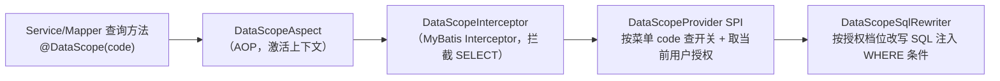

## 1. 模块定位

MyBatis-Flex 深度整合模块，坐标 `top.mddata.base:md-db-mybatis-flex`。负责 ORM 层的全局定制：数据权限、SQL 审计、逻辑删除、主键生成器对接、审计字段自动填充。依赖 md-db、md-util、mybatis-flex。

## 2. 源码解读

```
top.mddata.base.mybatisflex
├── config/
│   ├── MdMybatisFlexConfiguration.java      # 抽象配置：extends DbConfiguration implements MyBatisFlexCustomizer
│   └── DataScopeAutoConfiguration.java      # 数据权限自动配置（imports 注册，flex.data-scope=true 生效）
├── datascope/                               # 数据权限套件
│   ├── annotation/DataScope.java            # 方法埋点注解
│   ├── context/DataScopeAspect.java         # AOP 切面：方法执行期间激活拦截
│   ├── context/DataScopeContext.java        # 线程上下文（注解声明传递）
│   ├── engine/DataScopeInterceptor.java     # MyBatis Interceptor：拦截 SELECT 注入数据范围条件
│   ├── engine/DataScopeMerger.java          # 多授权档位条件合并
│   ├── engine/DataScopeSqlRewriter.java     # SQL 解析改写（JSqlParser）
│   ├── model/DataScopeCurrentUser.java      # 数据载体（当前用户视图 + 授权集合）
│   ├── model/DataScopeEnum.java             # 权限范围枚举（全部/本组织及以下/本组织/仅本人/自定义）
│   ├── model/DataScopeGrant.java            # 单条授权记录
│   ├── spi/DataScopeProvider.java           # SPI：应用需提供实现（用户/菜单/授权数据来源）
│   └── spi/DataScopeCustomHandler.java      # SPI：自定义档位条件构建器（按 Bean 名配置）
├── keygen/UidKeyGenerator.java              # 主键生成器：调用 UidGenerator
├── listener/                                # 全局监听器
│   ├── DefaultInsertListener.java           # 插入自动填充（创建人/时间）
│   └── DefaultUpdateListener.java           # 更新自动填充（修改人/时间）
├── logicdelete/TimeStampDelByLogicDeleteProcessor.java  # 默认逻辑删除处理器
├── dialect/AuthDialectImpl.java             # （预留）
└── utils/BeanPageUtil.java
```

### 2.1 MdMybatisFlexConfiguration

实现 `MyBatisFlexCustomizer.customize(FlexGlobalConfig)`，启动时依次装配（`MdMybatisFlexConfiguration.java:80-93`）：

1. `audit()`：按 `flex.audit` 开启审计，按 `flex.audit-collector` 选择收集器（默认打 INFO 日志，并抑制操作日志落库链路自身的 SQL，避免级联刷屏）；
2. `uid()`：把 `UidKeyGenerator` 注册进 KeyGeneratorFactory（主键生成对接 md-db 的 UidGenerator）；
3. `logicDelete()`：按 `flex.logic-delete-processor` 设置 6 种处理器之一（默认 TIME_STAMP_DEL_BY）；
4. 全局监听器：`DefaultInsertListener` / `DefaultUpdateListener` 注册给 `BaseEntity` 的所有子类——**创建/更新时间与操作人的自动填充就在这里**；
5. `DatabaseIdProvider`：Oracle/MySQL/SQLServer 的 databaseId 映射（多数据库 SQL 切换用）。

### 2.2 数据权限套件（DataScope）



- `@DataScope`（方法级埋点）：`code()`（菜单 code，**必填**，全局唯一业务键）；`orgColumn()`（组织类档位过滤列，不声明则该查询不支持组织类档位）；`userColumn()`（仅本人档过滤列，默认 `created_by`）；`tableAliases()`（过滤目标表别名，支持多个；单表可省略，多表语句省略会 fail fast）；
- `DataScopeProvider` 是**应用必须实现的 SPI**——引擎不依赖业务模块，MDP 由 md-common-config 提供实现：从登录上下文取用户、按菜单 code 查菜单开关、按用户角色查授权；
- `DataScopeCustomHandler` 是自定义档位的扩展 SPI：实现类注册为 Spring Bean，授权记录（`data_scope_impl`）配置 Bean 名，返回 SQL 条件片段由引擎以 AND 注入 WHERE。单个实现返回空白会被忽略，但一条授权链上的实现全部返回空白时引擎按配置错误 **fail fast** 抛异常；
- `DataScopeInterceptor` 是普通 MyBatis Interceptor Bean，由 MyBatis-Flex 自动配置收集注册到所有 SqlSessionFactory，无需手动挂接。

## 3. 可配置参数

本模块配置全部在 md-db 的 `DatabaseProperties`（前缀 `mdp.database`），与持久层相关的关键项：

| 配置项 | 默认值 | 说明 |
|---|---|---|
| `mdp.database.flex.data-scope` | false | **数据权限总开关**（`DataScopeAutoConfiguration` 的 `@ConditionalOnProperty`，matchIfMissing=false） |
| `mdp.database.flex.audit` | false | SQL 审计开关 |
| `mdp.database.flex.audit-collector` | DEFAULTS | 收集器：DEFAULTS/CONSOLE/COUNTABLE/SCHEDULED |
| `mdp.database.flex.logic-delete-processor` | TIME_STAMP_DEL_BY_LOGIC_DELETE_PROCESSOR | 逻辑删除处理器（6 种） |
| `mdp.database.flex.deleted-by-column` | deleted_by | 逻辑删除人字段名 |
| `mdp.database.id-type` 及 `default-id/cache-id/hutool-id.*` | — | 主键生成参数（经 UidKeyGenerator 生效） |

## 4. 扩展点

| 扩展点 | 类型 | 说明 |
|---|---|---|
| `DataScopeProvider` | SPI（应用必须实现） | 提供菜单开关与当前用户授权数据；MDP 由 md-common-config 实现 |
| `DataScopeCustomHandler` | SPI（按需实现） | 自定义数据范围档位，授权记录配置 Bean 名生效 |
| 审计字段填充 | 监听器 | `DefaultInsert/UpdateListener` 针对 `BaseEntity`；新填充字段可加监听器 |
| `TimeStampDelByLogicDeleteProcessor` | 类 | 换逻辑删除语义走配置枚举，无需写代码 |

## 5. 功能扩展建议

| 想做什么 | 推荐做法 |
|---|---|
| 按部门隔离数据 | `flex.data-scope=true` + Service 方法加 `@DataScope(code = "菜单code", orgColumn = "...")` + 确认应用实现了 `DataScopeProvider` |
| 看 SQL 性能 | `flex.audit=true` + `audit-collector=COUNTABLE` 做量级统计 |
| 自定义审计输出 | 实现自己的 `MessageCollector`（参考 `MdMybatisFlexConfiguration#audit` 的装配方式） |

## 6. 二次开发注意事项

::: warning 开数据权限的三个前提
1. `mdp.database.flex.data-scope=true`（默认关）；2. Spring 容器里有 `DataScopeProvider` Bean（MDP 各服务由 md-common-config 提供实现）；3. `@DataScope` 的 `code` 必须是已在控制台开启数据权限的菜单 code，且 `orgColumn`/`userColumn`（默认 `created_by`）与你的表结构一致。
:::

::: warning 字段填充依赖 BaseEntity
`DefaultInsertListener/UpdateListener` 只对 `BaseEntity` 子类生效；自定义实体没继承 `BaseEntity` 就不会有创建人/时间的自动填充。
:::

::: warning 多表查询必须声明 tableAliases
`@DataScope` 省略 `tableAliases` 时仅允许单表语句，多表语句会 fail fast；多表查询必须显式声明要过滤的表别名，引擎只改写声明别名涉及的表。
:::
