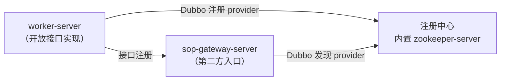

开放平台链路用于**对第三方系统提供接口**（ISV 应用经统一网关调用 MDP 开放接口），与业务服务的区别在于：业务服务供 Web/移动端**前端**调用（浏览器登录态鉴权），开放平台供第三方**服务器**调用（appKey + accessToken + RSA2 签名）。

开放平台的角色划分（两种部署形态一致）：

| 进程 | 角色 | 端口 | 说明 |
| ---- | ---- | :--: | ---- |
| sop-gateway-server | 第三方统一入口 | 23456 | 验签/鉴权/路由/调用日志，两种形态**都必须单独启动** |
| worker-server（单体版） | 开放接口实现 | 23457 | 单体版由它兼任（`dubbo.enabled: true`） |
| api-server（微服务版） | 开放接口实现 | 23454 | 微服务版的独立实现进程 |

网关通过 **Dubbo 泛化调用**打到接口实现进程，因此这条链路**必须有注册中心**（dev 可用内置 zookeeper-server，test/prod 必须 Nacos）。

::: tip 深入阅读

本文只讲启动。开放平台的架构、接口开发、文档发布、应用审核等完整内容见[开放平台（开发进阶）](../../advanced/open/README.md)。

:::

## 一、单体版启动开放平台

单体版开放接口链路的依赖关系（箭头指向谁，谁就先启动）：



### 1. 启动 zookeeper-server（仅 dev）

不用额外安装 ZooKeeper：直接运行 `ZookeeperRegistryServer` 的 main 方法，在 **2181** 端口拉起一个嵌入式 ZooKeeper。

::: danger 仅限开发演示

1. 内置 ZooKeeper **禁止用于生产**（启动时会打 WARN 日志提示）。测试、生产环境请改用 Nacos：把 Maven profile 切到 `test` / `prod` 重新编译，Dubbo 的注册中心依赖与地址会自动换成 Nacos。

2. 微服务版本本地环境也可以直接使用nacos，无需考虑ZooKeeper。

:::

### 2. 启动 sop-gateway-server

1. 数据库、SQL 已在业务服务启动时准备完成，**不用重复导入**（与 boot-server 共用一个 `mdp` 库）。

2. 修改 `sop-gateway-server/src/main/resources/application-dev.yml`（只有三块配置）：

   ```yml
   spring:
     data:
       redis:
         host: <REDIS_HOST>
         port: <REDIS_PORT>
         password: '<REDIS_PASSWORD>'
         database: 6          # 与 boot-server、worker-server 保持一致
     datasource:
       druid:
         driverClassName: com.mysql.cj.jdbc.Driver
         username: '<DB_USERNAME>'
         password: '<DB_PASSWORD>'
         url: jdbc:mysql://<DB_HOST>:3306/mdp?serverTimezone=Asia/Shanghai&characterEncoding=utf8&useUnicode=true&useSSL=false&autoReconnect=true&zeroDateTimeBehavior=convertToNull&allowMultiQueries=true&nullCatalogMeansCurrent=true

   dubbo:
     registry:
       address: zookeeper://localhost:2181   # dev 用内置 zookeeper；test/prod 换成 nacos://...
   ```

3. 启动 `SopGatewayServerApplication`，监听 **23456**。专属配置见[开放平台网关配置](../../../config/开放平台网关配置.md)。

### 3. 启动 worker-server（开放接口角色）

1. 修改 `worker-server/src/main/resources/application-dev.yml`：Redis、数据源同上，两处开关按「只跑开放接口」配置：

   ```yml
   dubbo:
     # ⭐️ 需要使用开放接口功能时开启
     enabled: true
     registry:
       address: zookeeper://localhost:2181

   powerjob:
     worker:
       # ⭐️ 只测开放接口、不测定时任务时保持 false
       enabled: false
   ```

2. 启动 `WorkerServerApplication`。

::: warning worker-server 的配置不来自 Nacos

即使在微服务版里，worker-server 也**不接入 Nacos 配置中心**，Nacos 对它只承担 Dubbo 服务发现。切换环境时它的数据库、Redis 要单独在 `application-{env}.yml` 里改。

:::

> 两处 Dubbo 细节：`dubbo.protocol.port: -1` 表示**随机端口**，无需为 Dubbo 单独放行固定端口；`dubbo.consumer.retries: 0` 是有意关闭重试，避免超时重试导致服务端重复处理。

### 4. 验证

1. worker-server 启动后会把 `@Open` 接口自动注册进网关（失败会每 5 秒重试）——查数据库 `mdo_api` 表应有接口记录（`accessToken.get`、`user.page` 等）；
2. 用 SDK 或 curl 调通换取令牌接口（需要先在平台创建应用并配置 RSA 公钥，见[准备工作](../../../integration/准备工作.md)）：

   ```shell
   curl -X POST 'http://localhost:23456/api' \
     -d 'appKey=您的appKey' -d 'method=accessToken.get' -d 'version=1.0' \
     -d 'format=json' -d 'charset=utf-8' -d 'timestamp=2026-10-25 12:00:00' \
     -d 'signType=RSA2' -d 'sign=按签名规则计算' \
     -d 'bizContent={"appKey":"您的appKey","appSecret":"您的appSecret"}'
   ```

## 二、微服务版启动开放平台

微服务版中开放接口实现由独立的 **api-server** 承担，注册中心统一用 Nacos。

### 1. 启动 api-server

api-server 的配置从 Nacos 拉取（dataId `api-server.yml`，含端口 23454 与 `dubbo` 配置，随配置包一并导入，见[微服务版启动](微服务版启动.md)）。确认其中 **Dubbo 注册中心地址指向你的 Nacos**，然后启动 `ApiServerApplication`。

### 2. 改 sop-gateway-server 的注册中心（仅 dev 包需要）

sop-gateway-server 不接 Nacos 配置中心，且 `dev` profile 默认引 ZooKeeper 客户端——微服务版要让它连 Nacos，需改两处：

```xml
<!-- mdp-apps/md-gateway/sop-gateway-server/pom.xml，dev profile 内 -->
<!-- 修改前：dubbo-zookeeper-curator5-spring-boot-starter -->
<!-- 修改后：与 api-server 保持一致的 nacos 注册中心客户端 -->
<dependency>
    <groupId>org.apache.dubbo</groupId>
    <artifactId>dubbo-nacos-spring-boot-starter</artifactId>
</dependency>
```

```yaml
# sop-gateway-server/src/main/resources/application-dev.yml
dubbo:
  registry:
    address: nacos://${NACOS_IP:@config.nacos.ip@}:${NACOS_PORT:@config.nacos.port@}
    parameters:
      namespace: ${NACOS_NAMESPACE:@config.nacos.namespace@}      # 命名空间填 ID
      username: ${NACOS_USERNAME:@config.nacos.username@}
      password: ${NACOS_PASSWORD:@config.nacos.password@}
```

> 该 pom 已开启资源过滤并挂 filters 文件，上述 `${...:@config...@}` 写法可直接使用：运行期用环境变量覆盖、编译期由 `mdp-apps/src/main/filters/config-{env}.properties` 兜底，见[编译期配置（filters）](../../../config/编译期配置filters.md)。`test` / `prod` profile 本来就引 Nacos，无需这处改动。

### 3. worker-server 务必关掉开放接口能力

worker-server 同时打包了「开放接口」和「定时任务执行器」两种能力，`test`/`prod` 出厂值**两项全开**。微服务版里开放接口应由 api-server 承担，必须显式关闭，否则它会和 api-server 注册成同一批 provider，被网关轮询到，表现为「同样的接口有时通有时不通」：

```yaml
# worker-server/src/main/resources/application-{env}.yml
dubbo:
  enabled: false        # 不导出 provider、不向网关上报接口，只做执行器
```

### 4. 验证

- Nacos → 服务列表（Dubbo 分组，默认 `dubbo`）：出现 5 个开放接口的 provider 条目（Org / User / Msg / Token / Demo），提供者应为 **api-server**（若出现 worker-server，说明上一步的开关没配）；
- 调通 `accessToken.get`（同单体版第 4 步）。

## 三、常见问题

| 现象 | 原因与处理 |
| ---- | ---------- |
| 第三方调开放接口报找不到服务提供者 | 注册中心没起（dev 的 zookeeper-server）、接口实现进程没起、或 `dubbo.enabled` 为 `false` |
| 接口时通时不通（微服务版） | worker-server 漏配 `dubbo.enabled: false`，与 api-server 同时成了 provider |
| 微服务版 dev 包网关连不上注册中心 | sop-gateway-server 的 dev profile 默认连 ZooKeeper，按第二节第 2 步换依赖并改地址 |
| 接口配好了却调不通、缓存像没生效 | sop-gateway 与业务服务的 `spring.data.redis.database` 不一致（共用同一套缓存，必须一致） |
| 接口注册不进去（mdo_api 无记录） | 看接口实现进程日志：注册失败每 5 秒重试一次，常见原因是注册中心不通，详见[接口开发与发布](../../advanced/open/接口开发与发布.md) |
